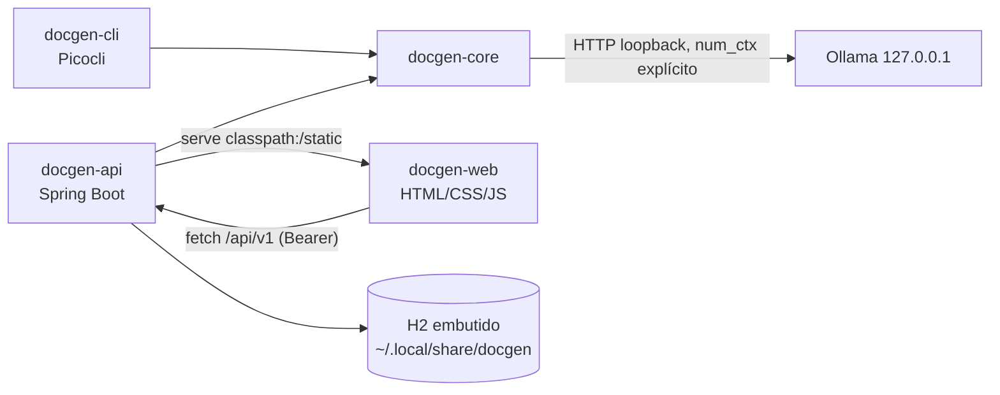
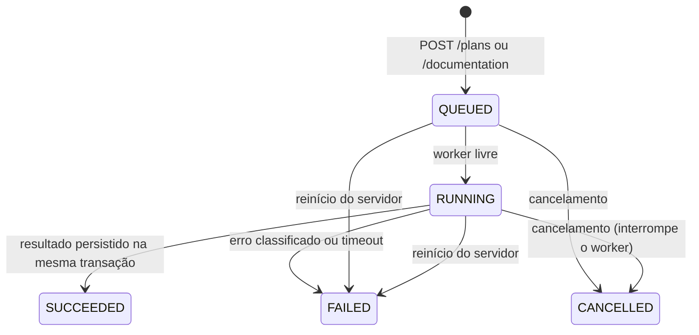

# Arquitetura

O DocGen é um Maven reactor com quatro módulos. O núcleo (`docgen-core`) concentra as regras de varredura, segurança, prompts, provedores e validação, e não depende de HTTP, Servlet, HTML ou terminal. As interfaces (CLI e API/Web) apenas adaptam entradas e saídas para esse núcleo.

```text
docgen/
├── pom.xml            (reactor: versões, plugins, SBOM por artefato)
├── docgen-core/       motor reutilizável (Java 21 + Jackson 2)
├── docgen-cli/        interface Picocli → target/docgen.jar (shaded)
├── docgen-web/        workspace web estático (HTML, CSS, ES Modules) → classpath:/static
└── docgen-api/        Spring Boot 4.1 (REST, segurança, jobs, H2, PDFBox, OSHI) → docgen-api.jar
```



Dependências entre módulos: `docgen-cli → docgen-core`; `docgen-api → docgen-core` e `docgen-api → docgen-web` (somente em runtime). A CLI não conhece a API, o Spring ou o PDFBox, e o SBOM dela continua listando apenas o core, Jackson e Picocli.

## docgen-core

### Pipeline de documentação de repositórios (CLI e API)

```text
DocGenCLI / RepositoryAnalysisService
  -> DocumentationRequest
  -> DocumentationService
      -> RepoScanner (+ DocgenIgnore, SecretRedactor)
      -> [análise/dry-run termina aqui]
      -> preflight seguro de saída/pré-visualização (quando há persistência)
      -> PromptBuilder
      -> [pré-visualização de prompt termina aqui, antes de existir provedor]
      -> LLMProviderFactory
          -> OllamaProvider (127.0.0.1, num_ctx explícito)
      -> DocumentationValidator
      -> OutputWriter (revalida antes da publicação)
  -> DocumentationResult
```

- `DocumentationService` orquestra varredura, verificação de seleção vazia, preflight de persistência, construção de prompts, criação do provedor local, validação de resposta e publicação opcional. Emite progresso por interface e propaga exceções sem escrever no terminal.
- `DocumentationRequest` é uma entrada tipada do servidor. Seus caminhos são configuração confiável, nunca campos de HTTP: a API resolve identificadores autorizados (`docgen.repositories`) em caminhos. `DocumentationResult` devolve metadados relativos e artefatos gerados, sem caminhos absolutos nem código-fonte bruto.
- `RepoScanner` percorre a árvore somente por handles `SecureDirectoryStream`, rejeita symlinks e sistemas de arquivos inseguros, aplica exclusões internas, de ignore e de allowlist de forma determinística, redige o arquivo completo e limitado antes do truncamento e impõe limites de entradas, profundidade, quantidade de arquivos, caminho, árvore, metadados e conteúdo. Apenas os pulos por limite de conteúdo chegam ao modelo.
- `DocgenIgnore` carrega `.docgenignore` (raiz) e os `.gitignore` da raiz e aninhados por handles seguros. O matcher iterativo suporta curingas comuns do Git sem backtracking de regex, reserva orçamentos globais de globs, segmentos e NFA antes de compilar e impede que negações de diretório cancelem regras mais específicas de filhos. `.docgenignore` só exclui.
- `SecretRedactor` centraliza a remoção best-effort de tokens de nuvem e SaaS, blocos de chave privada, credenciais em URLs, cabeçalhos de autorização e atribuições de credenciais.
- `PromptBuilder` redige todo conteúdo, caminho e metadado visível no prompt, envolve o snapshot em delimitadores de dado não confiável, neutraliza tags que imitam esses delimitadores e reafirma as regras após o bloco de dados. Exige Markdown passivo.
- `RepoContext` carrega o snapshot e separa pulos visíveis no prompt (limites de tamanho) de exclusões apenas locais (arquivos sensíveis ou ignorados), cujos nomes nunca chegam ao prompt.
- `LLMProvider` é a abstração do modelo local; a única implementação é o `OllamaProvider`. `generateStructured()` pede um único objeto JSON e ativa o modo JSON do Ollama (`format: json`).
- `OllamaEndpoint` fixa o host no literal `127.0.0.1` (sem resolução de nome e sem configuração); só a porta muda (padrão `11434`, `--ollama-port` na CLI e `docgen.ollama.port` na API).
- `OllamaProvider` consulta `/api/show` para obter o contexto máximo do modelo (`<arquitetura>.context_length`), envia `num_ctx` (estimativa do prompt mais 8.192 tokens de reserva para a resposta, arredondada para múltiplos de 2.048 e limitada ao máximo do modelo) e `num_predict` igual à reserva. Prompt que não cabe gera `PromptTooLargeException` antes de qualquer envio, e modelo ausente gera `ModelNotInstalledException`, sem download. Também recebe a resposta dentro do timeout HTTP com teto de 16 MiB, limita linhas, fragmentos e saída NDJSON, exige marcador de conclusão e descarta a resposta (`PromptTruncatedException`) se o `prompt_eval_count` for implausivelmente baixo para o tamanho do prompt. Usa proxy direto e não segue redirecionamentos.
- `PromptTokens` estima de forma conservadora os tokens de um prompt por classe de caractere. O Qwen separa cada dígito em um token, então dígitos, dados densos (base64, hex) e pontuação em sequência pesam mais. A calibração contra contagens reais do Ollama fica fixada em teste. Sem `num_ctx`, o Ollama usa 4k tokens abaixo de 24 GiB de VRAM e corta em silêncio o início de prompts maiores, onde ficam as regras de segurança.
- `HttpExchange` impõe prazo fim a fim, incluindo o consumo do corpo, e espera de forma interrompível: interromper a thread aborta a chamada em andamento.
- `DocumentationValidator` limita e redige novamente a saída do modelo, valida Unicode e estrutura Markdown e impõe o contrato de H1 e Markdown passivo antes da publicação.
- `SecurePairWriter` é compartilhado pelos writers de documentação e pré-visualização. Exige um diretório de saída existente, confiável e não compartilhado (rejeita diretórios POSIX graváveis por grupo ou outros), abre todos os ancestrais com handles seguros, prepara a saída por canais privados `CREATE_NEW`, verifica identidade e digest, publica sem substituir um destino que surja concorrentemente e restaura originais em quarentena em ordem reversa se algo falhar.
- `OutputWriter` e `PromptPreviewWriter` escolhem o par de destino. Nenhum substitui arquivos existentes sem `--force`; o preflight somente leitura falha antes de qualquer prompt ou provedor, e a escrita repete as validações para conter corridas.

### Planejamento arquitetural de projetos (Web/API)

```text
ProjectBrief + SupportingDocument[] (texto de PDFs)
  -> ArchitecturePlanningService.prepare()      (sem rede)
      -> ProjectPromptBuilder.buildPlanningPrompt
  -> Preparation (prompt exato)
  -> ArchitecturePlanningService.plan()
      -> LLMProvider.generateStructured (Ollama local)
      -> ArchitecturePlanParser (validação e saneamento)
      -> MermaidDiagram.fromPlan + validate
  -> Result (ArchitecturePlan, mermaid, avisos)

ProjectBrief + ArchitecturePlan aprovado
  -> ProjectDocumentationService.prepare()      (sem rede)
  -> ProjectDocumentationService.generate()
      -> LLMProvider.generateDocumentation (README e ARCHITECTURE, Ollama local)
      -> DocumentationValidator (UnsafeOutputException se reprovar)
      -> MermaidDiagram
```

- `ProjectBrief` é a descrição do projeto informada pelo usuário: nome, descrição, requisitos funcionais e não funcionais, tecnologias preferidas, restrições e idioma de saída. O construtor normaliza e limita tudo (`UntrustedText`), de modo que CLI, API e testes compartilham os mesmos limites.
- `SupportingDocument` é o texto extraído de um anexo. É dado não confiável e só entra no prompt dentro de `<attached_documents>`.
- `UntrustedText` remove caracteres de controle e de formatação invisíveis (incluindo overrides bidirecionais), descarta surrogates órfãos e não caracteres, unifica quebras de linha, aplica NFC e limita o tamanho respeitando code points.
- `ProjectPromptBuilder` aplica as mesmas defesas do `PromptBuilder` (regras antes dos dados, delimitadores neutralizados, segredos redigidos e reforço após o bloco). Os anexos dividem um orçamento fixo de 30.000 caracteres e o prompt inteiro é limitado a 64.000. Os prompts de documentação afirmam que o projeto está em planejamento e proíbem inventar comandos, URLs, versões ou alegações de conformidade.
- `ArchitecturePlan` é a representação estruturada e validável do plano: resumo, objetivos, requisitos (com `Source`), estilo arquitetural, componentes (com `ComponentType`), relacionamentos, fluxo de dados, tecnologias, integrações, segurança, persistência, fases de implementação, riscos (com `Impact`), decisões, premissas e perguntas em aberto.
- `ArchitecturePlanParser` trata a saída do modelo como hostil:
  - JSON limitado em tamanho (256 KiB), profundidade e strings;
  - toda string é normalizada, limitada e redigida;
  - enums desconhecidos caem em valores seguros;
  - identificadores de componentes viram slugs restritos (`[a-z0-9-]`, únicos);
  - relacionamentos para componentes inexistentes são descartados, com aviso;
  - listas são limitadas.

  Os requisitos marcados como `USER` são copiados literalmente do `ProjectBrief`: o modelo nunca consegue rotular texto próprio como informado pelo usuário, e o que ele alega como `USER` vira `AI_SUGGESTION`. Esse é o mecanismo que separa fatos fornecidos por pessoas de recomendações da IA.
- `ArchitecturePlanJson` é o formato de persistência (leitura estrita, propriedades desconhecidas falham), separado do parser de saída do modelo.
- `MermaidDiagram` gera Mermaid a partir da estrutura. Os IDs de nó são gerados (`n1`, `n2`…), os rótulos passam por allowlist de caracteres e nunca são emitidos `click`, `style`, `classDef`, diretivas `%%{init}%%`, links ou HTML. `validate()` reconfere cada linha contra uma gramática mínima. O diagrama é um artefato separado e não altera as regras de Markdown passivo.
- `LLMProviderResolver` e `ProviderSelection` desacoplam a criação do provedor a partir do modelo escolhido (testes injetam provedores falsos) e restringem nomes de modelo a `[A-Za-z0-9][A-Za-z0-9._:/-]{0,99}`.

## docgen-api

Aplicação Spring Boot 4.1.1 (Spring Framework 7, Spring Security 7, Jackson 3 na camada HTTP), restrita a `127.0.0.1`. É também o app desktop: a classe principal do JAR é `com.docgen.desktop.DesktopLauncher` (ADR [0001](docs/adr/0001-shell-desktop.md)).

### Launcher desktop (`com.docgen.desktop`)

Um processo só, que é o servidor e abre a interface no navegador. O launcher roda **antes** do Spring:

1. `AppDirectories` resolve o diretório de dados por SO (XDG no Linux, `Application Support` no macOS, `%LOCALAPPDATA%` no Windows) e `PrivateFiles` o cria com `0700`, recusando links simbólicos.
2. `InstanceLock` tenta a trava `instance.lock` (`FileChannel.tryLock`, liberada pelo SO se o processo morrer). Se outra instância a tem, o launcher lê o `instance.json` (`InstanceFile`: porta, PID e segredo, `0600`), pede uma janela nova com `ReopenClient` (`POST /api/v1/desktop/reopen`, loopback, sem proxy, sem redirecionamento) e termina. Sem `instance.json`, a outra instância ainda está subindo e abrirá a própria janela.
3. Com a trava, apaga um `instance.json` deixado por queda, executa uma compactação do banco pendente (`LocalDatabase`) e sobe o Spring em `127.0.0.1`, porta `0` (o SO escolhe), com o diretório de dados como propriedade de maior precedência e log rotacionado em `<dados>/logs`.
4. Com o servidor pronto, grava o `instance.json` de forma atômica, instala o ícone de bandeja quando há suporte (`DesktopTray`) e abre `/launch#<token>` com um token de lançamento novo. `SystemBrowsers` tenta um Chromium em modo `--app`, depois `Desktop#browse`, depois `xdg-open`/`open`/`rundll32`, sempre sem shell e com caminho absoluto; se nada abrir, `DesktopNotices` oferece "Copiar link de acesso".
5. O launcher é o `DesktopControl` do contexto Spring (registrado antes do refresh): a API pede por ele uma janela nova ou o encerramento. O encerramento roda numa thread não daemon, fecha o contexto (e o pool do H2), apaga o `instance.json`, compacta o banco se a remoção de dados pediu, libera a trava e encerra o processo.

A dependência é de mão única: `com.docgen.desktop` usa a API (`DocGenApiApplication`, `LaunchTokenService`, `DesktopControl`, `LocalDatabase`, `PrivateFiles`), e a API não conhece o launcher. Sem ele (testes e desenvolvimento), as rotas desktop respondem que o app não está rodando como desktop.

| Responsabilidade | Classes |
|---|---|
| Bootstrap e configuração | `DocGenApiApplication`, `DocGenApiProperties`, `StorageConfig`, `LocalDatabase`, `PrivateFiles`, `ProviderConfig`, `StrictJsonConfig`, `WebConfig` |
| Segurança | `SecurityConfig`, `LaunchTokenService`, `SessionTokenService`, `SessionController`, `BearerTokenAuthenticationFilter`, `HostHeaderFilter`, `OriginPolicyFilter`, `LoopbackAuthority`, `RequestPolicyFilter`, `CurrentUser`, `Secrets` |
| Ciclo de vida desktop | `DesktopControl`, `DesktopController`, `PresenceTracker`, `ActivityTracker`, `IdleShutdownMonitor`, `DataController`, `DataErasureService` |
| Erros | `ApiExceptionHandler`, `ApiExceptions` (códigos e mensagens fixas) |
| Projetos | `ProjectController`, `ProjectService`, `ProjectRepository`, `ProjectDtos` |
| Anexos/PDF | `AttachmentController`, `AttachmentService`, `AttachmentRepository`, `PdfTextExtractor` |
| Planejamento e documentação | `WorkflowController`, `AiWorkflowService`, `PlanService`, `PlanRepository`, `ArtifactService`, `ArtifactRepository`, `WorkflowDtos` |
| Jobs | `JobController`, `JobService`, `JobRepository`, `JobFailures` |
| Repositórios autorizados (Fase 02) | `ApiController`, `AuthorizedRepositoryRegistry`, `RepositoryAnalysisService` |
| Retenção | `RetentionJanitor` |
| Ollama, modelos e preferências (Fase 3) | `ModelsConfig`, `ModelController`, `ModelService`, `ModelPullService`, `ModelDtos`, `OllamaFailures`, `SettingsController`, `SettingsService`, `AppSettingsRepository` |
| Diagnóstico de hardware (`com.docgen.hardware`) | `HardwareProbe`, `SystemHardwareProbe` (OSHI), `NvidiaSmi`, `BoundedCommand`, `OllamaModelsDirectory`, `HardwareProfile` |
| Catálogo e recomendação (`com.docgen.models`) | `ModelCatalog` (`models/qwen-catalog.json`), `CatalogModel`, `ModelRecommender` (puro), `MemoryEstimate`, `ModelFit` |

### Ollama, hardware e modelos (Fase 3)

No core, `OllamaClient` (que implementa `OllamaApi`) é o cliente completo do Ollama local: `version`, `tags`, `show`, `ps`, `delete`, `pull` e `chat` em streaming. `OllamaStream` faz o streaming NDJSON com watchdog de inatividade e prazo total, limites de bytes e linhas e cancelamento por `Cancellation`, que fecha a conexão (é isso que faz o Ollama parar). `RemoteModels` reconhece modelos que rodam fora do computador (`remote_host`, `remote_model`, tag `cloud`), e `ThinkingFilter` separa o raciocínio de modelos Qwen3+ da resposta. O `OllamaProvider` da documentação usa o mesmo `describe` para recusar modelos remotos e pedir `think: false`.

Na API, `SystemHardwareProbe` lê o hardware com OSHI, sem rede, e confirma a VRAM pelo driver (ou pelo `nvidia-smi` opcional). `ModelRecommender` estima a memória de cada modelo do catálogo e o classifica para a máquina (ADR [0004](docs/adr/0004-catalogo-e-recomendacao-de-modelos.md)). `ModelPullService` faz um download por vez, só de tags do catálogo, e marca a atividade para o app não se encerrar no meio.

### Contratos REST (`/api/v1`)

| Método e rota | Autenticação | Descrição | Sucesso |
|---|---|---|---|
| `GET /health` | pública | Disponibilidade. | 200 |
| `POST /session` | token de lançamento | `{launchToken}` → `{accessToken, tokenType: "Bearer", idleTimeoutSeconds}`. Token inválido ou expirado: `401 launch_token_invalid`; reusado: `409 launch_token_reused` (e a sessão criada com ele termina). Nunca define cookie. | 201 |
| `GET /session` · `DELETE /session` | sim | Estado da sessão (`{owner: "local", idleTimeoutSeconds}`) e encerramento da sessão atual. | 200 · 204 |
| `POST /desktop/heartbeat` | sim | A janela está aberta (a cada minuto). | 204 |
| `POST /desktop/shutdown` | sim | "Sair do DocGen": responde e depois encerra o app. Sem o launcher: `409 desktop_unavailable`. | 202 |
| `POST /desktop/reopen` | segredo da instância | Só para a segunda execução do app: cabeçalho `X-DocGen-Instance-Secret`; recusa `Origin` e `Sec-Fetch-*` (`403`). | 202 |
| `DELETE /data` | sim | "Apagar todos os meus dados". | 204 |
| `GET /ollama/status` | sim | `{reachable, version, address, testedVersion}`; Ollama fora do ar é estado, não erro. | 200 |
| `GET /hardware` | sim | Diagnóstico (`null` = não detectado) e o status do Ollama. | 200 |
| `GET /models/catalog` | sim | Catálogo com classe, motivo e estimativa para esta máquina, orçamento e sugestões (geral e código); funciona sem o Ollama. | 200 |
| `GET /models` | sim | Instalados, com uso de memória do `/api/ps`, se estão no catálogo, se são remotos e se o DocGen pode usá-los. | 200 |
| `GET /models/details?name=` · `DELETE /models?name=` | sim | Detalhes (`/api/show`) e remoção (`/api/delete`); o nome vai na query porque uma tag pode ter `/`. | 200 · 204 |
| `POST /models/test` | sim | `{model}`: teste rápido de inferência (só catálogo e local). | 200 |
| `POST /models/pulls` · `GET /models/pulls` | sim | Inicia o download de uma tag do catálogo (`409 already_installed`, `409 pull_in_progress`, `507 insufficient_disk`) e lista os recentes. | 202 · 200 |
| `GET` · `DELETE /models/pulls/{id}` | sim | Progresso (etapa, bytes, velocidade) e cancelamento. | 200 · 202 |
| `GET /settings` · `PUT /settings/default-model` · `PUT /settings/onboarding` | sim | Modelo padrão (tag do catálogo instalada e local) e fim da configuração inicial. | 200 |
| `POST /repositories/{id}/analysis` | sim | Análise (sem IA) de um repositório autorizado no servidor. | 200 |
| `POST /projects` · `GET /projects` | sim | Cria ou lista os projetos do usuário (lista com estatísticas). | 201 · 200 |
| `GET` · `PUT` · `DELETE /projects/{id}` | sim | Detalhe, atualização e exclusão (cancela os jobs do projeto). | 200 · 200 · 204 |
| `POST /projects/{id}/attachments` | sim | Corpo bruto `application/pdf`; nome de exibição em `X-Attachment-Name` (URL-encoded). | 201 |
| `GET /projects/{id}/attachments` · `DELETE …/{attachmentId}` | sim | Lista (com trecho extraído) e remoção. | 200 · 204 |
| `POST /projects/{id}/plans` | sim | `{provider?, model?}` (`provider` só aceita `ollama`) → job assíncrono. | 202 |
| `GET /projects/{id}/plans` · `GET …/{planId}` | sim | Lista e plano completo (`origin: AI_GENERATED`, `requiresHumanReview: true`). | 200 |
| `POST /projects/{id}/plans/{planId}/approval` | sim | Revisão humana: marca o plano como `APPROVED`. | 200 |
| `POST /projects/{id}/documentation` | sim | `{planId, provider?, model?}`; exige plano aprovado → job. | 202 |
| `GET /jobs/{id}` · `POST /jobs/{id}/cancellation` | sim | Estado do job e cancelamento. | 200 |
| `GET /projects/{id}/jobs` | sim | Histórico de interações do projeto. | 200 |
| `GET /artifacts` · `GET /projects/{id}/artifacts` | sim | Documentos do usuário ou do projeto. | 200 |
| `GET` · `PUT /projects/{id}/artifacts/{artifactId}` | sim | Leitura e edição (`{content, expectedRevision}`), com Markdown passivo e revisão otimista. | 200 |
| `GET /projects/{id}/artifacts/{artifactId}/content` | sim | Download com nome fixo. | 200 |
| `GET /projects/{id}/export?planId=` | sim | ZIP com `README.md`, `ARCHITECTURE.md`, `architecture.mmd` e `architecture-plan.json`. | 200 |

Todos os erros usam o formato `{"status": 409, "code": "plan_not_approved", "message": "…"}`, com códigos estáveis e mensagens fixas: nada vindo de exceções, caminhos ou provedores é ecoado. Códigos HTTP usados: 400 (`invalid_request`, `invalid_host`), 401 (`authentication_required`, `launch_token_invalid`), 403 (`access_denied`), 404 (`not_found`, inclusive para recursos de outro usuário), 409 (`plan_not_approved`, `revision_conflict`, `duplicate_attachment`, `attachment_limit`, `job_not_cancellable`, `artifact_read_only`, `nothing_to_export`), 413 (`request_too_large`), 415 (`unsupported_media_type`), 422 (`pdf_invalid`, `pdf_encrypted`, `pdf_no_text`, `pdf_too_many_pages`, `pdf_timeout`, `unsafe_markdown`, `not_in_catalog`, `remote_model_refused`), 429 (`too_many_jobs`, `queue_full`), 502 (`ollama_failed`), 503 (`ollama_unavailable`), 504 (`ollama_timeout`) e 507 (`insufficient_disk`).

### Jobs assíncronos



- Pool fixo de workers (`docgen.jobs.workers`, padrão 2), fila limitada (16; fila cheia gera 429), no máximo 3 jobs ativos e timeout por job (padrão 15 min) controlado por um watchdog.
- Na submissão, a API tira um snapshot da entrada exata (o prompt montado na hora) e a thread do worker apenas chama o Ollama local.
- Toda transição é compare-and-set no banco (`WHERE status = …`). O resultado (plano ou artefatos) é gravado na mesma transação de `RUNNING → SUCCEEDED`, então um job cancelado, expirado ou cujo projeto foi excluído nunca publica resultado.
- Cancelamento: `QUEUED` sai da fila antes de começar; `RUNNING` interrompe o worker, o que aborta a chamada HTTP ao Ollama (espera interrompível em `HttpExchange`). Interrupções só são entregues enquanto o worker executa código do provedor, nunca durante escrita no H2.
- Falhas são mapeadas por `JobFailures` para códigos (`provider_timeout`, `provider_unavailable`, `provider_failed`, `model_not_installed`, `prompt_too_large`, `prompt_truncated`, `invalid_model_output`, `unsafe_model_output`, `timeout`, `interrupted`…) com mensagens fixas. O log registra só código e classe da exceção.
- O cliente acompanha por polling (`GET /jobs/{id}`), com backoff de 0,7 s a 3 s. SSE ou WebSocket não foram necessários.

### Persistência

H2 embutido em modo arquivo no diretório de dados do launcher (`0700`; por SO, veja acima), acesso via `JdbcClient` com SQL explícito e migrações Flyway versionadas: `V1__initial_schema.sql`; `V2__projetos_somente_ollama.sql`, que move para o Ollama os projetos de provedores removidos e mantém o provedor histórico de planos e jobs; `V3__dono_local_fixo.sql`, que passa os donos da v2 para o dono fixo `local`; e `V4__configuracoes_locais.sql`, com as preferências (modelo padrão e fim da configuração inicial). Tabelas: `projects`, `attachments`, `plans`, `artifacts`, `jobs` e `app_settings`. Toda linha tem `owner`, e toda consulta filtra por `id` **e** `owner`, como segunda barreira mesmo com um dono só. "Apagar todos os meus dados" pede um `SHUTDOWN COMPACT` (`LocalDatabase`), executado quando nenhum pool está aberto: na saída do app ou no início seguinte.

| Dado | Guardado? | Política |
|---|---|---|
| Bytes brutos do PDF | não | Arquivo temporário privado, apagado após a extração em qualquer desfecho; o staging é limpo na inicialização. |
| Texto extraído do PDF | sim, redigido e limitado | Necessário para planejar; expira (`expires_at`, padrão 30 dias) e é apagado com o anexo ou o projeto. |
| Prompts | não | Montados em memória na hora do job. |
| Plano e documentos | sim | Removidos com o projeto. |
| Jobs | sim | Registros finalizados há mais de 30 dias são apagados. |
| Tokens de sessão | só em memória | Somente o hash SHA-256 do token de sessão; tudo se perde ao reiniciar. |
| Credenciais de provedor | não existem | O único provedor é o Ollama local, sem chave. |

### Upload e extração de PDF

`AttachmentController` recebe o corpo bruto `application/pdf`; o multipart do Spring fica desativado. O `RequestPolicyFilter` limita o corpo enquanto ele é lido. `AttachmentService` grava o stream num arquivo de staging com nome aleatório e permissão `0600`, calcula o SHA-256 (rejeitando duplicatas no projeto) e chama o `PdfTextExtractor`, que:

1. confere a assinatura `%PDF-`;
2. abre o arquivo com PDFBox 3.0.8 sob orçamento de memória e scratch (32 MiB e 256 MiB) dentro do staging privado;
3. rejeita PDFs criptografados, com mais de 200 páginas ou sem texto;
4. extrai página a página, com cancelamento cooperativo, até 200.000 caracteres;
5. roda num pool dedicado de duas threads com prazo de 60 s.

O texto é normalizado, redigido e persistido; o arquivo temporário é apagado no `finally`. O nome enviado pelo cliente só serve para exibição: é decodificado, reduzido ao último segmento e normalizado, e nunca vira caminho.

## docgen-web

Frontend sem framework: HTML5, CSS3 e JavaScript com ES Modules nativos, servido pela própria API (mesma origem, sem build e sem dependências npm). A decisão segue o portfólio original e a política de CSP `script-src 'self'`; nenhuma necessidade concreta justificou React ou Vue.

| Módulo | Responsabilidade |
|---|---|
| `launch.html`, `js/launch.js`, `js/launch-flow.js` | Página `/launch`: lê o token de lançamento do fragmento, apaga o fragmento da barra de endereços antes de qualquer requisição, troca o token pela sessão e vai para `/`; explica em PT-BR quando o link expirou ou foi reusado. |
| `js/main.js` | Shell (sidebar, topbar), roteamento por hash, cancelamento de polling ao trocar de tela (`AbortController`) e "Sair do DocGen". Sem sessão, mostra como abrir o app pelo atalho; não há tela de login. |
| `js/heartbeat.js`, `js/views/access.js` | Heartbeat a cada minuto enquanto a janela está aberta (duas falhas de rede seguidas = app encerrado) e as telas fora da shell (sem sessão, link inválido, app encerrado). |
| `js/api.js` | Cliente HTTP: token de sessão só no `sessionStorage` e só no cabeçalho `Authorization`, `credentials: 'omit'`, `redirect: 'error'`, `ApiError` com códigos. |
| `js/dom.js`, `js/url.js` | Construção de DOM só com `createElement`/`textContent`/`setAttribute`; allowlist de URLs; nunca `innerHTML`. |
| `js/markdown.js` | Parser de Markdown próprio → AST → DOM. HTML bruto vira texto, imagens não são carregadas, links passam pela allowlist. |
| `js/diagram.js` | Layout em camadas (rank por caminho mais longo, quebra de ciclos, ordenação por baricentro) e renderização SVG interativa (zoom, pan, foco por teclado, destaque de conexões, exportação SVG autocontida). |
| `js/jobs.js` | Polling com backoff e abort. |
| `js/validation.js` | Validação de formulário espelhando os limites do servidor. |
| `js/views/*`, `js/components/*` | Dashboard, projetos, novo projeto, workspace (descrição, anexos, IA, histórico e abas de resultados), documentações, configurações, anexos, plano, diagrama e documentos. |
| `js/views/onboarding.js`, `js/views/models.js`, `js/components/model-ui.js` | Configuração inicial em sete etapas (abre sozinha enquanto não for concluída) e tela Modelos: status do Ollama, diagnóstico, catálogo classificado, download confirmado com progresso e cancelamento, instalados, teste, padrão e remoção. |
| `js/models.js`, `js/pulls.js`, `js/links.js` | Funções puras dos modelos (rótulos, progresso, checagem de disco, "não detectado"), acompanhamento do download por polling e os dois únicos links externos (páginas oficiais do Ollama, abertas pelo usuário). |

O diagrama interativo é desenhado a partir da estrutura do plano, não do texto Mermaid. O navegador nunca executa Mermaid, o que elimina essa superfície de execução; o Mermaid validado no servidor é oferecido para cópia e no ZIP.

## Fronteiras de segurança

- **Somente local:** os únicos destinos de rede do código Java são o Ollama em `127.0.0.1` (host fixo, porta configurável, sem proxy e sem redirecionamentos) e, na segunda execução do app, a própria instância já aberta, também em `127.0.0.1`. A única saída para a internet é o download de modelo, feito pelo próprio Ollama, de uma tag do catálogo, depois de um clique explícito; modelos que rodam fora do computador são recusados antes de qualquer envio (ADR 0003). Não existe provedor remoto. `LocalOnlyArchitectureTest` reprova o build se o código de produção de qualquer módulo ganhar uma URI HTTP(S) fora do loopback, outro cliente de rede ou outra implementação de `LLMProvider`. No frontend, a CSP `connect-src 'self'` e os testes estáticos impedem chamadas e recursos externos.
- **Dados não confiáveis:** arquivos do repositório, texto do usuário, texto de PDFs e saída do modelo são não confiáveis em todo o pipeline. O endurecimento de prompts reduz o risco de manipulação; a validação de saída (parser do plano, Mermaid restrito, Markdown passivo) limita o que é persistido e exibido. Nada disso prova correção semântica: planos e documentos exigem revisão humana, e a aprovação do plano é um passo explícito antes da documentação.
- **Acesso à API local:** só quem recebeu um token de lançamento do launcher (a janela que ele abriu) obtém uma sessão; outros processos e outros usuários do computador recebem `401`, páginas de outras origens recebem `403`, e `Host` estranho recebe `400` (ADR 0002).
- **Isolamento por dono:** todo recurso é escopado por `owner` (fixo em `local`, mantido como segunda barreira); IDs são UUIDs opacos; recursos de outro dono respondem 404.
- **Detalhes:** veja [SECURITY.md](SECURITY.md).

## Decisões arquiteturais

| Decisão | Motivo | Trade-off |
|---|---|---|
| Core em Jackson 2.21; API em Jackson 3.1 (padrão do Spring Boot 4) | Mantém o JAR da CLI e o SBOM inalterados; os pacotes (`com.fasterxml` e `tools.jackson`) convivem sem conflito, compartilhando `jackson-annotations` 2.21. | Duas versões de databind na API. |
| Rigidez de JSON em código (`StrictJsonConfig`), não só no YAML | Os testes da Fase 02 falharam porque um `application.yml` de teste sobrepunha o principal; segurança não pode depender do arquivo carregado. | — |
| H2 embutido em vez de SQLite | Puro Java (sem biblioteca nativa), file lock impede duas instâncias no mesmo diretório, suporte nativo no Flyway. | Banco de uso local, não pensado para alta concorrência. |
| Launcher no mesmo processo, UI no navegador (ADR 0001) | Um processo, sem Electron, Tauri ou JavaFX; reaproveita a SPA atual e o navegador do sistema. | A vida do processo não acompanha a da aba: daí o heartbeat, o desligamento por inatividade e a bandeja opcional. |
| Token de lançamento de uso único → token de sessão Bearer em `sessionStorage`, sem cookie (ADR 0002) | Sem login nem terminal; cookies não são isolados por porta (RFC 6265, §8.5), e o `sessionStorage` é isolado por origem e nunca anexado automaticamente; somado à regra de Content-Type, à validação de `Origin` e à ausência de CORS, elimina as condições do CSRF. | O token de lançamento aparece por segundos na linha de comando do navegador (detecção de reuso); o token de sessão fica legível para um XSS (mitigado por CSP estrita e ausência de sinks HTML). |
| PDF como corpo bruto em vez de multipart | Limite exato em stream, sem arquivos temporários do container e sem nome de arquivo em caminho. | Um arquivo por requisição. |
| Polling HTTP em vez de SSE ou WebSocket | Jobs duram de segundos a minutos; polling é suficiente e mais simples de proteger. | Latência de até 3 s para notar a conclusão. |
| Renderizador SVG próprio em vez de Mermaid no navegador | Sem execução de diagramas, sem dependência de ~3 MB e compatível com CSP estrita. | Layout mais simples que o do Mermaid. |
| Sem framework de frontend | Alinhado ao portfólio, zero dependências, CSP `script-src 'self'` sem build. | Componentes escritos à mão. |

## Build e release

`mvn -B verify` compila com `--release 21`, executa os testes de todos os módulos e gera um SBOM CycloneDX 1.6 por artefato distribuído: `target/docgen.cdx.json` (CLI) e `target/docgen-api.cdx.json` (API). O `maven-shade-plugin` continua produzindo `target/docgen.jar`, com o mesmo nome e local consumidos pelo `release.yml`, pelo `install.sh` e pelo wrapper `./docgen`. O `spring-boot-maven-plugin` produz `docgen-api/target/docgen-api.jar`, que inclui o `docgen-web`.

A CI executa:

- `mvn verify` e os testes do frontend (`node --test`);
- CodeQL para Java e para JavaScript, com a suíte `security-extended`;
- Dependency Review em pull requests;
- varredura OSV completa, também semanal.

O workflow de release está restrito a `brunocorreia-dev/Docgen`. A varredura e o build usam o commit imutável do evento de release; o build depende de uma varredura OSV limpa, roda `mvn verify` e gera checksums do JAR e do SBOM da CLI num job limitado a `contents: read`. Um job separado baixa esses artefatos, não faz checkout nem executa o Maven, e é o único que recebe `id-token: write` e `contents: write` para assinar os quatro arquivos com cosign keyless via OIDC do GitHub Actions e publicá-los com os bundles `*.sigstore.json`. Todas as actions externas estão fixadas por SHA completo. O `install.sh` baixa a release mais recente, sempre verifica o checksum do JAR com parsing estrito e, quando o cosign está presente, verifica as assinaturas do JAR e do checksum contra a identidade do workflow de release numa tag. O JAR da API ainda **não** é publicado em releases (veja a seção de evolução no README).

## Empacotamento e distribuição

| Módulo | Artefato | Conteúdo |
|---|---|---|
| `docgen-core` | (biblioteca) | Varredura, prompts, provedores, planejamento e validação. |
| `docgen-cli` | `target/docgen.jar` | CLI shaded (picocli). Instalada por `install.sh`. |
| `docgen-web` | `docgen-web-<versão>.jar` | Recursos estáticos (`static/`) do workspace. |
| `docgen-api` | `docgen-api/target/docgen-api.jar` | O app desktop: Spring Boot executável (classe inicial `com.docgen.desktop.DesktopLauncher`) que inclui `docgen-web` em `BOOT-INF/lib` e serve o frontend na mesma origem da API. `java -jar docgen-api.jar` abre o app sem nenhuma configuração. A release publicada (v2.0.0) ainda é instalada por `install-web.sh`. |

O workflow `release.yml` constrói os dois JARs, gera SBOM e checksum de cada um e os assina com Sigstore em um job separado.
