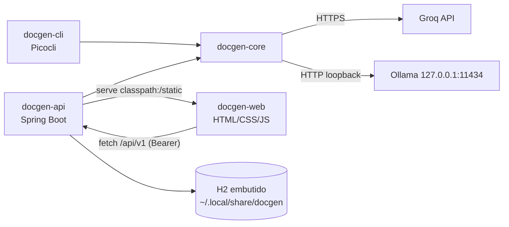
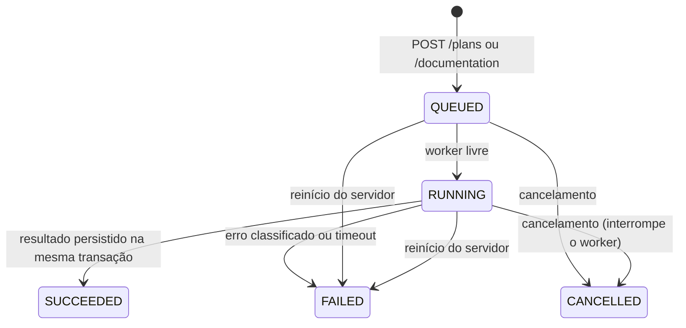

# Arquitetura

O DocGen é um Maven reactor com quatro módulos. O núcleo (`docgen-core`) concentra as regras de varredura, segurança, prompts, provedores e validação, e não depende de HTTP, Servlet, HTML ou terminal. As interfaces (CLI e API/Web) apenas adaptam entradas e saídas para esse núcleo.

```text
docgen/
├── pom.xml            (reactor: versões, plugins, SBOM por artefato)
├── docgen-core/       motor reutilizável (Java 21 + Jackson 2)
├── docgen-cli/        interface Picocli → target/docgen.jar (shaded)
├── docgen-web/        workspace web estático (HTML, CSS, ES Modules) → classpath:/static
└── docgen-api/        Spring Boot 4.1 (REST, segurança, jobs, H2, PDFBox) → docgen-api.jar
```



Dependências entre módulos: `docgen-cli → docgen-core`; `docgen-api → docgen-core` e `docgen-api → docgen-web` (somente em runtime). A CLI não conhece a API, o Spring ou o PDFBox, e o SBOM dela continua listando apenas o core, Jackson e Picocli.

## docgen-core

### Pipeline de documentação de repositórios (CLI e API)

```text
DocGenCLI / RepositoryAnalysisService
  -> DocumentationRequest
  -> DocumentationService
      -> RepoScanner (+ DocgenIgnore, SecretRedactor)
      -> [análise/dry-run termina aqui]
      -> preflight seguro de saída/pré-visualização (quando há persistência)
      -> PromptBuilder
      -> [pré-visualização de prompt termina aqui, antes de existir provedor]
      -> LLMProviderFactory
          -> GroqProvider | OllamaProvider
      -> DocumentationValidator
      -> OutputWriter (revalida antes da publicação)
  -> DocumentationResult
```

- `DocumentationService` orquestra varredura, verificação de seleção vazia, preflight de persistência, construção de prompts, seleção de provedor, callback de autorização remota, validação de resposta e publicação opcional. Emite progresso por interface e propaga exceções sem escrever no terminal.
- `DocumentationRequest` é uma entrada tipada do servidor. Seus caminhos são configuração confiável, nunca campos de HTTP: a API resolve identificadores autorizados (`docgen.repositories`) em caminhos. `DocumentationResult` devolve metadados relativos e artefatos gerados, sem caminhos absolutos nem código-fonte bruto.
- `RepoScanner` percorre a árvore somente por handles `SecureDirectoryStream`, rejeita symlinks e sistemas de arquivos inseguros, aplica exclusões internas, de ignore e de allowlist de forma determinística, redige o arquivo completo e limitado antes do truncamento e impõe limites de entradas, profundidade, quantidade de arquivos, caminho, árvore, metadados e conteúdo. Apenas os pulos por limite de conteúdo chegam ao modelo.
- `DocgenIgnore` carrega `.docgenignore` (raiz) e os `.gitignore` da raiz e aninhados por handles seguros. O matcher iterativo suporta curingas comuns do Git sem backtracking de regex, reserva orçamentos globais de globs, segmentos e NFA antes de compilar e impede que negações de diretório cancelem regras mais específicas de filhos. `.docgenignore` só exclui.
- `SecretRedactor` centraliza a remoção best-effort de tokens de nuvem e SaaS, blocos de chave privada, credenciais em URLs, cabeçalhos de autorização e atribuições de credenciais.
- `PromptBuilder` redige todo conteúdo, caminho e metadado visível no prompt, envolve o snapshot em delimitadores de dado não confiável, neutraliza tags que imitam esses delimitadores e reafirma as regras após o bloco de dados. Exige Markdown passivo.
- `RepoContext` carrega o snapshot e separa pulos visíveis no prompt (limites de tamanho) de exclusões apenas locais (arquivos sensíveis ou ignorados), cujos nomes nunca chegam ao prompt.
- `LLMProvider` é a abstração de provedor. As implementações declaram `isRemote()` e `describeDestination()`, que alimentam a fronteira obrigatória de consentimento remoto. `generateStructured()` pede um único objeto JSON e ativa o modo JSON do provedor quando existe (`response_format: json_object` no Groq, `format: json` no Ollama).
- `GroqProvider` chama o endpoint HTTPS fixo do Groq com retentativas limitadas, descarta corpos de erro, limita os bytes da resposta e exige `finish_reason: stop`.
- `OllamaProvider` chama endpoints fixos em `127.0.0.1` sem proxy do sistema, recebe a resposta completa dentro do timeout HTTP com teto de 16 MiB, limita linhas, fragmentos e saída NDJSON e exige marcador de conclusão.
- `HttpExchange` impõe prazo fim a fim, incluindo o consumo do corpo, e espera de forma interrompível: interromper a thread aborta a chamada em andamento.
- `DocumentationValidator` limita e redige novamente a saída do modelo, valida Unicode e estrutura Markdown e impõe o contrato de H1 e Markdown passivo antes da publicação.
- `SecurePairWriter` é compartilhado pelos writers de documentação e pré-visualização. Exige um diretório de saída existente, confiável e não compartilhado (rejeita diretórios POSIX graváveis por grupo ou outros), abre todos os ancestrais com handles seguros, prepara a saída por canais privados `CREATE_NEW`, verifica identidade e digest, publica sem substituir um destino que surja concorrentemente e restaura originais em quarentena em ordem reversa se algo falhar.
- `OutputWriter` e `PromptPreviewWriter` escolhem o par de destino. Nenhum substitui arquivos existentes sem `--force`; o preflight somente leitura falha antes de qualquer prompt ou provedor, e a escrita repete as validações para conter corridas.

### Planejamento arquitetural de projetos (Web/API)

```text
ProjectBrief + SupportingDocument[] (texto de PDFs)
  -> ArchitecturePlanningService.prepare()      (sem rede)
      -> ProjectPromptBuilder.buildPlanningPrompt
  -> Preparation (prompt exato, digest SHA-256)
  -> ArchitecturePlanningService.plan()
      -> RemoteGate (allowRemote + RemoteConsent)
      -> LLMProvider.generateStructured
      -> ArchitecturePlanParser (validação e saneamento)
      -> MermaidDiagram.fromPlan + validate
  -> Result (ArchitecturePlan, mermaid, avisos)

ProjectBrief + ArchitecturePlan aprovado
  -> ProjectDocumentationService.prepare()      (sem rede)
  -> ProjectDocumentationService.generate()
      -> RemoteGate
      -> LLMProvider.generateDocumentation (README e ARCHITECTURE)
      -> DocumentationValidator (UnsafeOutputException se reprovar)
      -> MermaidDiagram
```

- `ProjectBrief` é a descrição do projeto informada pelo usuário: nome, descrição, requisitos funcionais e não funcionais, tecnologias preferidas, restrições e idioma de saída. O construtor normaliza e limita tudo (`UntrustedText`), de modo que CLI, API e testes compartilham os mesmos limites.
- `SupportingDocument` é o texto extraído de um anexo. É dado não confiável e só entra no prompt dentro de `<attached_documents>`.
- `UntrustedText` remove caracteres de controle e de formatação invisíveis (incluindo overrides bidirecionais), descarta surrogates órfãos e não caracteres, unifica quebras de linha, aplica NFC e limita o tamanho respeitando code points.
- `ProjectPromptBuilder` aplica as mesmas defesas do `PromptBuilder` (regras antes dos dados, delimitadores neutralizados, segredos redigidos e reforço após o bloco). Os anexos dividem um orçamento fixo de 30.000 caracteres e o prompt inteiro é limitado a 64.000. Os prompts de documentação afirmam que o projeto está em planejamento e proíbem inventar comandos, URLs, versões ou alegações de conformidade.
- `ArchitecturePlan` é a representação estruturada e validável do plano: resumo, objetivos, requisitos (com `Source`), estilo arquitetural, componentes (com `ComponentType`), relacionamentos, fluxo de dados, tecnologias, integrações, segurança, persistência, fases de implementação, riscos (com `Impact`), decisões, premissas e perguntas em aberto.
- `ArchitecturePlanParser` trata a saída do modelo como hostil:
  - JSON limitado em tamanho (256 KiB), profundidade e strings;
  - toda string é normalizada, limitada e redigida;
  - enums desconhecidos caem em valores seguros;
  - identificadores de componentes viram slugs restritos (`[a-z0-9-]`, únicos);
  - relacionamentos para componentes inexistentes são descartados, com aviso;
  - listas são limitadas.

  Os requisitos marcados como `USER` são copiados literalmente do `ProjectBrief`: o modelo nunca consegue rotular texto próprio como informado pelo usuário, e o que ele alega como `USER` vira `AI_SUGGESTION`. Esse é o mecanismo que separa fatos fornecidos por pessoas de recomendações da IA.
- `ArchitecturePlanJson` é o formato de persistência (leitura estrita, propriedades desconhecidas falham), separado do parser de saída do modelo.
- `MermaidDiagram` gera Mermaid a partir da estrutura. Os IDs de nó são gerados (`n1`, `n2`…), os rótulos passam por allowlist de caracteres e nunca são emitidos `click`, `style`, `classDef`, diretivas `%%{init}%%`, links ou HTML. `validate()` reconfere cada linha contra uma gramática mínima. O diagrama é um artefato separado e não altera as regras de Markdown passivo.
- `RemoteGate` concentra a fronteira remota usada pelos dois serviços: um provedor remoto só é usado com `allowRemote` e um `RemoteConsent` positivo para o destino e o tamanho concretos. Provedores locais não chamam o callback.
- `LLMProviderResolver` e `ProviderSelection` desacoplam a criação de provedores (testes injetam provedores falsos) e restringem nomes de modelo a `[A-Za-z0-9][A-Za-z0-9._:/-]{0,99}`.
- `PromptDigest` calcula SHA-256 sobre partes com prefixo de tamanho; a API usa esse digest para amarrar o consentimento ao conteúdo exato.

## docgen-api

Aplicação Spring Boot 4.1.1 (Spring Framework 7, Spring Security 7, Jackson 3 na camada HTTP), restrita a `127.0.0.1`.

| Responsabilidade | Classes |
|---|---|
| Bootstrap e configuração | `DocGenApiApplication`, `DocGenApiProperties`, `StorageConfig`, `ProviderConfig`, `StrictJsonConfig` |
| Segurança | `SecurityConfig`, `AuthTokenService`, `BearerTokenAuthenticationFilter`, `ThrottledAuthenticationManager`, `LoginThrottle`, `HostHeaderFilter`, `RequestPolicyFilter`, `CurrentUser` |
| Erros | `ApiExceptionHandler`, `ApiExceptions` (códigos e mensagens fixas) |
| Projetos | `ProjectController`, `ProjectService`, `ProjectRepository`, `ProjectDtos` |
| Anexos/PDF | `AttachmentController`, `AttachmentService`, `AttachmentRepository`, `PdfTextExtractor` |
| Consentimento | `RemoteConsentService` |
| Planejamento e documentação | `WorkflowController`, `AiWorkflowService`, `PlanService`, `PlanRepository`, `ArtifactService`, `ArtifactRepository`, `WorkflowDtos` |
| Jobs | `JobController`, `JobService`, `JobRepository`, `JobFailures` |
| Repositórios autorizados (Fase 02) | `ApiController`, `AuthorizedRepositoryRegistry`, `RepositoryAnalysisService` |
| Retenção | `RetentionJanitor` |

### Contratos REST (`/api/v1`)

| Método e rota | Autenticação | Descrição | Sucesso |
|---|---|---|---|
| `GET /health` | pública | Disponibilidade. | 200 |
| `GET /providers` | pública | Metadados estáticos: `id`, `remote`, `defaultModel`, `enabled` (gate do operador), `configured` (existe chave no servidor), `requiresConsent`. Nunca expõe chaves. | 200 |
| `POST /auth/token` | pública | `{username, password}` → `{accessToken, tokenType, expiresAt, username}`. | 200 |
| `GET /auth/session` | sim | Usuário da sessão. | 200 |
| `DELETE /auth/token` | sim | Revoga o token atual. | 204 |
| `POST /repositories/{id}/analysis` | sim | Análise (sem IA) de um repositório autorizado no servidor. | 200 |
| `POST /projects` · `GET /projects` | sim | Cria ou lista os projetos do usuário (lista com estatísticas). | 201 · 200 |
| `GET` · `PUT` · `DELETE /projects/{id}` | sim | Detalhe, atualização e exclusão (cancela os jobs do projeto). | 200 · 200 · 204 |
| `POST /projects/{id}/attachments` | sim | Corpo bruto `application/pdf`; nome de exibição em `X-Attachment-Name` (URL-encoded). | 201 |
| `GET /projects/{id}/attachments` · `DELETE …/{attachmentId}` | sim | Lista (com trecho extraído) e remoção. | 200 · 204 |
| `POST /projects/{id}/transmission-previews` | sim | `{operation: PLAN\|DOCUMENTATION, provider?, model?, planId?}` → destino, dados incluídos, tamanho exato e `consentToken` (somente provedor remoto). | 200 |
| `POST /projects/{id}/plans` | sim | `{provider?, model?, consentToken?}` → job assíncrono. | 202 |
| `GET /projects/{id}/plans` · `GET …/{planId}` | sim | Lista e plano completo (`origin: AI_GENERATED`, `requiresHumanReview: true`). | 200 |
| `POST /projects/{id}/plans/{planId}/approval` | sim | Revisão humana: marca o plano como `APPROVED`. | 200 |
| `POST /projects/{id}/documentation` | sim | `{planId, provider?, model?, consentToken?}`; exige plano aprovado → job. | 202 |
| `GET /jobs/{id}` · `POST /jobs/{id}/cancellation` | sim | Estado do job e cancelamento. | 200 |
| `GET /projects/{id}/jobs` | sim | Histórico de interações do projeto. | 200 |
| `GET /artifacts` · `GET /projects/{id}/artifacts` | sim | Documentos do usuário ou do projeto. | 200 |
| `GET` · `PUT /projects/{id}/artifacts/{artifactId}` | sim | Leitura e edição (`{content, expectedRevision}`), com Markdown passivo e revisão otimista. | 200 |
| `GET /projects/{id}/artifacts/{artifactId}/content` | sim | Download com nome fixo. | 200 |
| `GET /projects/{id}/export?planId=` | sim | ZIP com `README.md`, `ARCHITECTURE.md`, `architecture.mmd` e `architecture-plan.json`. | 200 |

Todos os erros usam o formato `{"status": 409, "code": "plan_not_approved", "message": "…"}`, com códigos estáveis e mensagens fixas: nada vindo de exceções, caminhos ou provedores é ecoado. Códigos HTTP usados: 400 (`invalid_request`, `invalid_host`), 401 (`authentication_required`, `invalid_credentials`), 403 (`access_denied`), 404 (`not_found`, inclusive para recursos de outro usuário), 409 (`consent_required`, `consent_invalid`, `consent_stale`, `remote_disabled`, `plan_not_approved`, `revision_conflict`, `duplicate_attachment`, `attachment_limit`, `job_not_cancellable`, `artifact_read_only`, `nothing_to_export`), 413 (`request_too_large`), 415 (`unsupported_media_type`), 422 (`pdf_invalid`, `pdf_encrypted`, `pdf_no_text`, `pdf_too_many_pages`, `pdf_timeout`, `unsafe_markdown`) e 429 (`too_many_attempts`, `too_many_jobs`, `queue_full`).

### Jobs assíncronos



- Pool fixo de workers (`docgen.jobs.workers`, padrão 2), fila limitada (16; fila cheia gera 429), no máximo 3 jobs ativos por usuário e timeout por job (padrão 15 min) controlado por um watchdog.
- Na submissão, a API tira um snapshot da entrada exata (o mesmo prompt cujo digest foi consentido) e a thread do worker apenas chama o provedor.
- Toda transição é compare-and-set no banco (`WHERE status = …`). O resultado (plano ou artefatos) é gravado na mesma transação de `RUNNING → SUCCEEDED`, então um job cancelado, expirado ou cujo projeto foi excluído nunca publica resultado.
- Cancelamento: `QUEUED` sai da fila antes de começar; `RUNNING` interrompe o worker, o que aborta a chamada HTTP ao provedor (espera interrompível em `HttpExchange`) e a pausa de retentativa do Groq. Interrupções só são entregues enquanto o worker executa código do provedor, nunca durante escrita no H2.
- Falhas são mapeadas por `JobFailures` para códigos (`provider_timeout`, `provider_unavailable`, `provider_rate_limited`, `invalid_model_output`, `unsafe_model_output`, `consent_required`, `timeout`, `interrupted`…) com mensagens fixas. O log registra só código e classe da exceção.
- O cliente acompanha por polling (`GET /jobs/{id}`), com backoff de 0,7 s a 3 s. SSE ou WebSocket não foram necessários.

### Persistência

H2 embutido em modo arquivo (`$DOCGEN_DATA_DIR`, padrão `$XDG_DATA_HOME/docgen` ou `~/.local/share/docgen`, com permissão `0700`), acesso via `JdbcClient` com SQL explícito e migrações Flyway versionadas (`db/migration/V1__initial_schema.sql`). Tabelas: `projects`, `attachments`, `plans`, `artifacts` e `jobs`. Toda linha tem `owner`, e toda consulta filtra por `id` **e** `owner`.

| Dado | Guardado? | Política |
|---|---|---|
| Bytes brutos do PDF | não | Arquivo temporário privado, apagado após a extração em qualquer desfecho; o staging é limpo na inicialização. |
| Texto extraído do PDF | sim, redigido e limitado | Necessário para planejar; expira (`expires_at`, padrão 30 dias) e é apagado com o anexo ou o projeto. |
| Prompts | não | Montados em memória na hora do job. |
| Plano e documentos | sim | Removidos com o projeto. |
| Jobs | sim | Registros finalizados há mais de 30 dias são apagados. |
| Tokens de sessão e consentimento | só em memória | Somente o hash SHA-256 do token de sessão; tudo se perde ao reiniciar. |
| Credenciais de provedor | não | `GROQ_API_KEY` só existe no ambiente do servidor. |

### Upload e extração de PDF

`AttachmentController` recebe o corpo bruto `application/pdf`; o multipart do Spring fica desativado. O `RequestPolicyFilter` limita o corpo enquanto ele é lido. `AttachmentService` grava o stream num arquivo de staging com nome aleatório e permissão `0600`, calcula o SHA-256 (rejeitando duplicatas no projeto) e chama o `PdfTextExtractor`, que:

1. confere a assinatura `%PDF-`;
2. abre o arquivo com PDFBox 3.0.8 sob orçamento de memória e scratch (32 MiB e 256 MiB) dentro do staging privado;
3. rejeita PDFs criptografados, com mais de 200 páginas ou sem texto;
4. extrai página a página, com cancelamento cooperativo, até 200.000 caracteres;
5. roda num pool dedicado de duas threads com prazo de 60 s.

O texto é normalizado, redigido e persistido; o arquivo temporário é apagado no `finally`. O nome enviado pelo cliente só serve para exibição: é decodificado, reduzido ao último segmento e normalizado, e nunca vira caminho.

## docgen-web

Frontend sem framework: HTML5, CSS3 e JavaScript com ES Modules nativos, servido pela própria API (mesma origem, sem build e sem dependências npm). A decisão segue o portfólio original e a política de CSP `script-src 'self'`; nenhuma necessidade concreta justificou React ou Vue.

| Módulo | Responsabilidade |
|---|---|
| `js/main.js` | Shell (sidebar, topbar), roteamento por hash e cancelamento de polling ao trocar de tela (`AbortController`). |
| `js/api.js` | Cliente HTTP: token Bearer em `sessionStorage`, `credentials: 'omit'`, `redirect: 'error'`, `ApiError` com códigos. |
| `js/dom.js`, `js/url.js` | Construção de DOM só com `createElement`/`textContent`/`setAttribute`; allowlist de URLs; nunca `innerHTML`. |
| `js/markdown.js` | Parser de Markdown próprio → AST → DOM. HTML bruto vira texto, imagens não são carregadas, links passam pela allowlist. |
| `js/diagram.js` | Layout em camadas (rank por caminho mais longo, quebra de ciclos, ordenação por baricentro) e renderização SVG interativa (zoom, pan, foco por teclado, destaque de conexões, exportação SVG autocontida). |
| `js/jobs.js` | Polling com backoff e abort. |
| `js/validation.js` | Validação de formulário espelhando os limites do servidor. |
| `js/views/*`, `js/components/*` | Dashboard, projetos, novo projeto, workspace (descrição, anexos, IA, histórico e abas de resultados), documentações, configurações, consentimento, anexos, plano, diagrama e documentos. |

O diagrama interativo é desenhado a partir da estrutura do plano, não do texto Mermaid. O navegador nunca executa Mermaid, o que elimina essa superfície de execução; o Mermaid validado no servidor é oferecido para cópia e no ZIP.

## Fronteiras de segurança

- **Remoto vs. local:** Groq é fronteira remota. No core, um provedor remoto exige `allowRemote` e um `RemoteConsent` positivo. Na CLI isso significa `--allow-remote` mais confirmação ou `--yes`. Na API, significa o gate do operador (`DOCGEN_ALLOW_REMOTE=true`) mais um token de consentimento de uso único, amarrado ao usuário, ao projeto, à operação, ao provedor, ao modelo e ao digest do prompt exato. Autenticação nunca é tratada como consentimento. Ollama é local porque recebe as requisições diretamente em `127.0.0.1:11434`, sem proxy.
- **Dados não confiáveis:** arquivos do repositório, texto do usuário, texto de PDFs e saída do modelo são não confiáveis em todo o pipeline. O endurecimento de prompts reduz o risco de manipulação; a validação de saída (parser do plano, Mermaid restrito, Markdown passivo) limita o que é persistido e exibido. Nada disso prova correção semântica: planos e documentos exigem revisão humana, e a aprovação do plano é um passo explícito antes da documentação.
- **Isolamento por usuário:** todo recurso é escopado por `owner`; IDs são UUIDs opacos; recursos de outro usuário respondem 404.
- **Detalhes:** veja [SECURITY.md](SECURITY.md).

## Decisões arquiteturais

| Decisão | Motivo | Trade-off |
|---|---|---|
| Core em Jackson 2.21; API em Jackson 3.1 (padrão do Spring Boot 4) | Mantém o JAR da CLI e o SBOM inalterados; os pacotes (`com.fasterxml` e `tools.jackson`) convivem sem conflito, compartilhando `jackson-annotations` 2.21. | Duas versões de databind na API. |
| Rigidez de JSON em código (`StrictJsonConfig`), não só no YAML | Os testes da Fase 02 falharam porque um `application.yml` de teste sobrepunha o principal; segurança não pode depender do arquivo carregado. | — |
| H2 embutido em vez de SQLite | Puro Java (sem biblioteca nativa), file lock impede duas instâncias no mesmo diretório, suporte nativo no Flyway. | Banco de uso local, não pensado para alta concorrência. |
| Bearer token opaco em vez de sessão por cookie + token CSRF | Credenciais nunca são anexadas automaticamente pelo navegador; somado à regra de Content-Type e à ausência de CORS, elimina as condições do CSRF. | Token fica no `sessionStorage` da aba (mitigado por CSP estrita e ausência de sinks HTML). |
| PDF como corpo bruto em vez de multipart | Limite exato em stream, sem arquivos temporários do container e sem nome de arquivo em caminho. | Um arquivo por requisição. |
| Polling HTTP em vez de SSE ou WebSocket | Jobs duram de segundos a minutos; polling é suficiente e mais simples de proteger. | Latência de até 3 s para notar a conclusão. |
| Renderizador SVG próprio em vez de Mermaid no navegador | Sem execução de diagramas, sem dependência de ~3 MB e compatível com CSP estrita. | Layout mais simples que o do Mermaid. |
| Sem framework de frontend | Alinhado ao portfólio, zero dependências, CSP `script-src 'self'` sem build. | Componentes escritos à mão. |

## Build e release

`mvn -B verify` compila com `--release 21`, executa os testes de todos os módulos e gera um SBOM CycloneDX 1.6 por artefato distribuído: `target/docgen.cdx.json` (CLI) e `target/docgen-api.cdx.json` (API). O `maven-shade-plugin` continua produzindo `target/docgen.jar`, com o mesmo nome e local consumidos pelo `release.yml`, pelo `install.sh` e pelo wrapper `./docgen`. O `spring-boot-maven-plugin` produz `docgen-api/target/docgen-api.jar`, que inclui o `docgen-web`.

A CI executa:

- `mvn verify` e os testes do frontend (`node --test`);
- CodeQL para Java e para JavaScript, com a suíte `security-extended`;
- Dependency Review em pull requests;
- varredura OSV completa, também semanal.

O workflow de release está restrito a `brunocorreia-dev/Docgen`. A varredura e o build usam o commit imutável do evento de release; o build depende de uma varredura OSV limpa, roda `mvn verify` e gera checksums do JAR e do SBOM da CLI num job limitado a `contents: read`. Um job separado baixa esses artefatos, não faz checkout nem executa o Maven, e é o único que recebe `id-token: write` e `contents: write` para assinar os quatro arquivos com cosign keyless via OIDC do GitHub Actions e publicá-los com os bundles `*.sigstore.json`. Todas as actions externas estão fixadas por SHA completo. O `install.sh` baixa a release mais recente, sempre verifica o checksum do JAR com parsing estrito e, quando o cosign está presente, verifica as assinaturas do JAR e do checksum contra a identidade do workflow de release numa tag. O JAR da API ainda **não** é publicado em releases (veja a seção de evolução no README).
