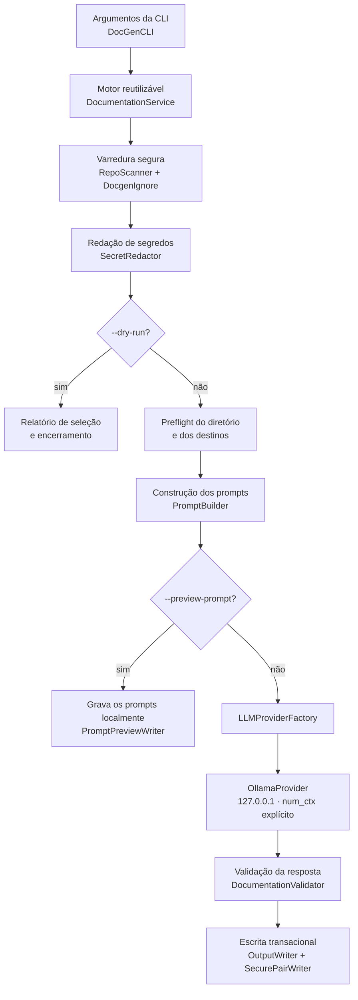
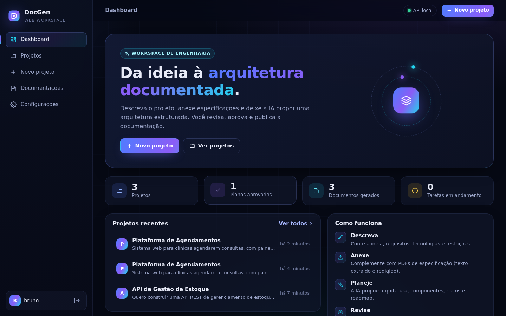
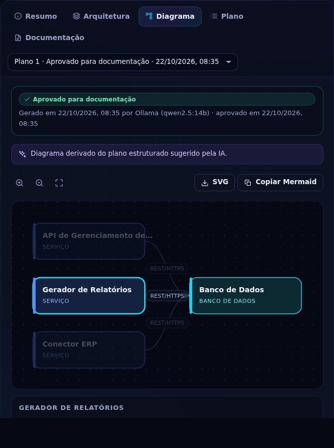
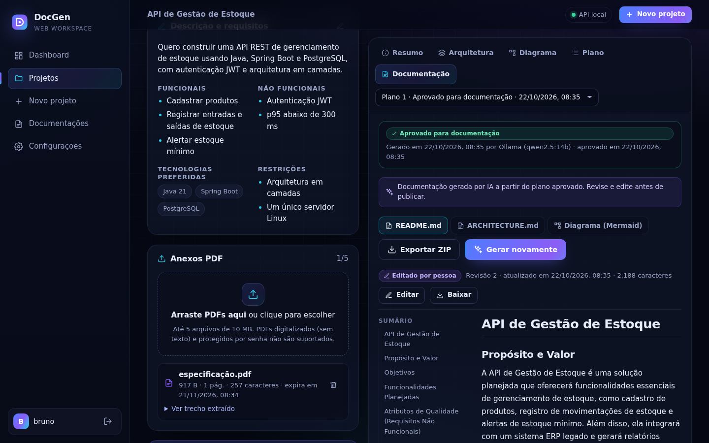

<div align="center">

# DocGen

**Plataforma em Java 21 para documentação e planejamento de arquitetura de software assistidos por IA local (Ollama), com segurança como padrão: CLI, API REST e workspace web.**

[](https://github.com/brunocorreia-dev/Docgen/actions/workflows/ci.yml)


[Visão geral](#visão-geral) ·
[Funcionalidades](#principais-funcionalidades) ·
[Instalação](#instalação) ·
[Uso](#guia-de-utilização) ·
[DocGen Web](#docgen-web) ·
[API REST](#api-rest) ·
[CLI](#referência-completa-da-cli) ·
[Segurança](#segurança) ·
[Arquitetura](#arquitetura-do-projeto) ·
[Qualidade](#testes-e-qualidade)

</div>

> [!NOTE]
> **Em desenvolvimento (3.0.0-SNAPSHOT):** o DocGen está sendo realinhado como um aplicativo desktop de IA local e gratuito, com modelos Qwen via Ollama. Desde esta versão, **todo o processamento é local**: não existe mais provedor remoto. O launcher e a configuração de modelos estão implementados; o chat e os instaladores seguem planejados.

| Entrega | Status nesta branch |
|---|---|
| Fase 1 · somente Ollama local | ✅ Implementado |
| Fase 2 · launcher desktop sem login | ✅ Implementado |
| Fase 3 · onboarding, catálogo e Modelos | ✅ Implementado; aguarda integração em `main` |
| Fase 4 · chat local | 🗺️ Planejado |
| Fase 5 · anexos no chat | 🗺️ Planejado |
| Fase 6 · Engenharia integrada ao chat | 🗺️ Planejado |
| Fase 7 · instaladores | 🗺️ Planejado |

---

## Sumário

- [Visão geral](#visão-geral)
- [Principais funcionalidades](#principais-funcionalidades)
- [Tecnologias utilizadas](#tecnologias-utilizadas)
- [Como o DocGen funciona](#como-o-docgen-funciona)
- [Pré-requisitos](#pré-requisitos)
- [Instalação](#instalação)
- [Guia de utilização](#guia-de-utilização)
- [Referência completa da CLI](#referência-completa-da-cli)
- [DocGen Web](#docgen-web)
- [API REST](#api-rest)
- [Segurança](#segurança)
- [Configuração da análise](#configuração-da-análise)
- [Arquitetura do projeto](#arquitetura-do-projeto)
- [Testes e qualidade](#testes-e-qualidade)
- [Distribuição e integridade](#distribuição-e-integridade)
- [Limitações conhecidas](#limitações-conhecidas)
- [Evolução do projeto](#evolução-do-projeto)
- [Autor](#autor)

## Visão geral

O **DocGen** nasceu como uma aplicação de linha de comando que lê um repositório local, seleciona os arquivos de texto relevantes e usa um modelo de linguagem (LLM) para redigir dois documentos:

| Documento | Conteúdo |
|---|---|
| `README.md` | Documentação geral do projeto. |
| `ARCHITECTURE.md` | Documentação da arquitetura de software. |

**O problema.** Documentação costuma ficar desatualizada ou nem chegar a ser escrita. Redigir um primeiro rascunho a partir do código é um trabalho repetitivo, que um LLM consegue acelerar. Ao mesmo tempo, enviar um repositório para um modelo traz riscos reais: vazamento de credenciais, envio não intencional de arquivos privados, prompt injection embutido no próprio código e respostas com conteúdo ativo indesejado.

**A abordagem.** O DocGen automatiza a geração do rascunho e trata o repositório como **dado não confiável** do início ao fim. A IA fica restrita a uma etapa bem delimitada do pipeline: recebe um retrato do repositório com limites rígidos de tamanho, segredos redigidos e conteúdo isolado por delimitadores. A resposta só é gravada em disco depois de passar por validações.

**DocGen Web.** Sobre o mesmo motor, o DocGen agora tem uma API REST (Spring Boot) e um workspace web. Nele você descreve a ideia de um projeto em linguagem natural, anexa PDFs de especificação, recebe da IA uma **proposta estruturada de arquitetura** (componentes, relacionamentos, tecnologias, riscos, decisões e roadmap) com diagrama interativo, revisa e aprova o plano e só então gera, edita e exporta `README.md` e `ARCHITECTURE.md`. A CLI continua independente e com o mesmo comportamento.

**Cenários de uso:**

- gerar um primeiro rascunho de documentação para projetos sem README;
- revisar ou atualizar a documentação de projetos existentes;
- documentar código de forma totalmente local, com o Ollama: nada sai da máquina;
- inspecionar com precisão o prompt que o modelo local receberia antes de gerar;
- planejar a arquitetura de um projeto novo a partir de requisitos e PDFs, com revisão humana antes de documentar.

> [!IMPORTANT]
> O DocGen produz **rascunhos**. A documentação gerada por IA pode conter imprecisões e deve ser revisada por uma pessoa antes de ser publicada.

## Principais funcionalidades

| Funcionalidade | Descrição |
|---|---|
| Análise automatizada de repositórios | Varredura determinística e limitada da árvore de arquivos, com seleção de arquivos de texto suportados. |
| Geração de README e arquitetura | Uma requisição para o `README.md` e outra para o `ARCHITECTURE.md`. |
| Integração com Ollama | Único provedor: o Ollama local em `127.0.0.1` (porta configurável, padrão `11434`), sem proxy do sistema. Modelo padrão: `qwen2.5-coder:7b`. |
| Execução local | Todo o processamento permanece na máquina; o DocGen não tem provedor remoto. |
| Janela de contexto explícita | Cada requisição informa `num_ctx` dimensionado pelo prompt. Se ele não couber no modelo, a geração falha antes de qualquer envio. |
| Modo de simulação (`--dry-run`) | Lista os arquivos incluídos e excluídos e encerra sem contatar nenhum provedor. |
| Pré-visualização de prompts (`--preview-prompt`) | Grava localmente os prompts exatos que seriam enviados, sem contatar nenhum provedor. |
| Exclusão de arquivos sensíveis | `.env*`, chaves privadas, keystores, `credentials*`, `*secret*`, contas de serviço e similares nunca são lidos. |
| Redação de segredos | Tokens conhecidos e credenciais são removidos do conteúdo e dos caminhos antes da montagem do prompt e novamente na resposta. |
| Respeito ao `.gitignore` | Arquivos `.gitignore` da raiz e aninhados são aplicados com semântica compatível com o Git. |
| Suporte a `.docgenignore` | Arquivo de exclusão adicional na raiz, apenas para exclusões. |
| Allowlist de extensões | `--include-ext` restringe a seleção a extensões específicas. |
| Controle de sobrescrita | Arquivos existentes só são substituídos com `--force`. |
| Validação da documentação gerada | Resposta completa, redigida novamente, limitada em tamanho e restrita a Markdown passivo. |
| Escrita transacional segura | Os dois arquivos são publicados como um par, com reversão em caso de falha. |

**No DocGen Web:**

| Funcionalidade | Descrição |
|---|---|
| Projetos | Criação, edição, listagem e exclusão de projetos a partir de descrição, requisitos funcionais e não funcionais, tecnologias, restrições, modelo e idioma. |
| Anexos PDF | Upload com drag-and-drop; extração de texto com Apache PDFBox, redação de segredos e limites rígidos. PDFs digitalizados (OCR) e protegidos por senha não são suportados. |
| Planejamento arquitetural com IA | Plano estruturado e validado: resumo, objetivos, requisitos (rotulados como seus, inferidos de anexo ou sugeridos pela IA), estilo, componentes, relacionamentos, fluxo de dados, tecnologias, integrações, segurança, persistência, fases, riscos, decisões, premissas e perguntas em aberto. |
| Diagrama interativo | SVG desenhado a partir do plano, com zoom, pan, navegação por teclado e destaque de conexões; exportação em SVG e em Mermaid validado no servidor. |
| Revisão humana | Planos nascem como rascunho; a documentação só é gerada a partir de um plano que você aprovou. |
| Documentação | Geração de README e ARCHITECTURE a partir do plano aprovado, preview Markdown com sumário, edição com validação de Markdown passivo e controle de revisão, download e exportação em ZIP. |
| Jobs assíncronos | Planejamento e documentação rodam em fila, com estados reais (`QUEUED`, `RUNNING`, `SUCCEEDED`, `FAILED`, `CANCELLED`), cancelamento, timeout e histórico. |
| Histórico | Projetos, planos, documentos e jobs persistidos localmente (H2, com migrações Flyway). |

## Tecnologias utilizadas

| Tecnologia | Versão | Responsabilidade |
|---|---|---|
| Java | 21 | Linguagem e runtime. Usa `java.net.http.HttpClient` e `SecureDirectoryStream` (NIO). |
| Maven | 3.9+ | Build, testes e empacotamento. |
| [picocli](https://picocli.info/) | 4.7.7 | Parsing dos argumentos da CLI, `--help` e `--version`. |
| Jackson Databind | 2.21.8 (core) · 3.1.5 (API) | JSON nos provedores e no plano (core) e na camada HTTP do Spring Boot (API). |
| Spring Boot | 4.1.1 | API REST (Spring MVC 7, Spring Security 7, Bean Validation, JDBC). |
| H2 Database | 2.4.240 | Banco embutido local, em arquivo, num diretório privado. |
| Flyway | 12.4.0 | Migrações versionadas do esquema. |
| Apache PDFBox | 3.0.8 | Extração de texto de PDFs, sem renderização. |
| HTML5, CSS3, ES Modules | — | Workspace web sem framework e sem build, servido pela API. |
| Node.js (`node:test`) | 20+ | Somente para os testes do frontend; nenhuma dependência npm. |
| JUnit Jupiter | 6.1.0 | Testes automatizados. |
| maven-shade-plugin | 3.6.2 | Gera o JAR executável da CLI `target/docgen.jar`, com as dependências incluídas. |
| spring-boot-maven-plugin | 4.1.1 | Gera `docgen-api/target/docgen-api.jar` (API e workspace web). |
| cyclonedx-maven-plugin | 2.9.2 | Gera SBOMs CycloneDX 1.6 por artefato (`target/docgen.cdx.json` e `target/docgen-api.cdx.json`) na fase `verify`. |
| Ollama | — | Provedor de LLM local, o único suportado. |
| GitHub Actions | — | CI, varreduras de segurança e pipeline de release. |
| CodeQL | — | Análise estática de Java e JavaScript com a suíte `security-extended`. |
| OSV-Scanner | — | Bloqueio de dependências com vulnerabilidades conhecidas. |
| Dependency Review | — | Revisão das mudanças de dependências em pull requests. |
| Dependabot | — | Atualização de dependências e das actions fixadas por SHA. |
| Sigstore / Cosign | — | Assinatura keyless dos artefatos de release e sua verificação. |

## Como o DocGen funciona

1. **Argumentos da CLI**: o picocli interpreta as opções em `DocGenCLI` e cria um `DocumentationRequest`.
2. **Orquestração reutilizável**: o `DocumentationService` executa o pipeline sem depender de terminal e devolve um `DocumentationResult` estruturado.
3. **Leitura do repositório**: o `RepoScanner` percorre a árvore apenas por meio de handles `SecureDirectoryStream`, sem seguir symlinks.
4. **Regras de exclusão**: exclusões internas, `.gitignore`, `.docgenignore` e `--include-ext`.
5. **Dados sensíveis**: arquivos sensíveis são ignorados e o `SecretRedactor` redige segredos no conteúdo e nos caminhos.
6. **Preflight**: o diretório de saída e os arquivos de destino são validados *antes* da construção dos prompts.
7. **Construção dos prompts**: o `PromptBuilder` isola o conteúdo como dado não confiável.
8. **Provedor**: o `LLMProviderFactory` cria o `OllamaProvider`, que consulta o contexto máximo do modelo e dimensiona `num_ctx`.
9. **Validação das respostas**: marcador de conclusão, nova redação e contrato de Markdown passivo (`DocumentationValidator`).
10. **Escrita segura**: o `OutputWriter` e o `SecurePairWriter` revalidam as condições e publicam o par de arquivos de forma transacional.



## Pré-requisitos

| Requisito | Detalhes |
|---|---|
| Java 21+ | Necessário para executar e compilar. |
| Maven 3.9+ | Necessário apenas para compilar a partir do código-fonte. |
| Ollama | Serviço em execução em `127.0.0.1` (porta `11434` ou a indicada em `--ollama-port`), com o modelo já instalado. O DocGen nunca baixa modelos sozinho. |
| Sistema de arquivos seguro | O provedor de sistema de arquivos do Java precisa implementar `SecureDirectoryStream`. Caso contrário, o DocGen falha (fail-closed) em vez de usar uma alternativa insegura. |
| Diretório de saída | Precisa **existir previamente**, ser confiável e não compartilhado. Em sistemas POSIX, não pode ter permissão de escrita para grupo ou outros usuários. |

> [!NOTE]
> Como a varredura e a escrita dependem de `SecureDirectoryStream`, sistemas de arquivos que não oferecem esse recurso são rejeitados. O DocGen nunca cria o diretório de saída por conta própria.

## Instalação

### Instalação por release

```bash
curl -fsSL https://raw.githubusercontent.com/brunocorreia-dev/Docgen/main/install.sh | sh
```

O script `install.sh`:

- exige Java instalado e `curl` ou `wget`, e aceita somente URLs HTTPS;
- baixa `docgen.jar` e `docgen.jar.sha256` da release mais recente de `brunocorreia-dev/Docgen`;
- **sempre** verifica o checksum SHA-256, que é interpretado de forma estrita;
- se o `cosign` estiver instalado, verifica as assinaturas Sigstore do JAR e do checksum, vinculadas ao workflow `release.yml` em uma tag;
- instala `docgen.jar` e o wrapper `docgen` em `$HOME/.local/bin`, diretório que pode ser alterado com `INSTALL_DIR`.

| Variável | Efeito |
|---|---|
| `INSTALL_DIR` | Diretório de instalação (padrão: `$HOME/.local/bin`). |
| `DOCGEN_REQUIRE_SIGNATURE=1` | Torna a verificação com cosign obrigatória. |
| `DOCGEN_SKIP_SIGNATURE=1` | Ignora explicitamente a verificação de assinatura e mantém só o checksum. |

As duas últimas variáveis são mutuamente exclusivas. Sem o cosign, o instalador continua apenas com o checksum e exibe um aviso.

### Instalação do DocGen Web por release (v2.0.0+)

O DocGen Web tem um instalador próprio. O `install.sh` continua instalando só a CLI, como antes.

```bash
curl -fsSL https://raw.githubusercontent.com/brunocorreia-dev/Docgen/main/install-web.sh | sh
```

O `install-web.sh` aplica as mesmas verificações do `install.sh` (HTTPS, checksum estrito, Sigstore com `cosign` e as variáveis `INSTALL_DIR`, `DOCGEN_REQUIRE_SIGNATURE` e `DOCGEN_SKIP_SIGNATURE`), mas baixa `docgen-api.jar` e instala o wrapper `docgen-web`. O frontend vem embutido no JAR e é servido pelo próprio Spring Boot.

> [!NOTE]
> O instalador baixa a **última release publicada (v2.0.0)**, que ainda exige usuário e senha em variáveis de ambiente. A versão em desenvolvimento (3.0.0) abre como app desktop, sem login (veja [Executar no Arch Linux](#executar-no-arch-linux)); ela ainda não tem release, e o `install-web.sh` será substituído pelos instaladores nativos (Fase 7).

### Compilação pelo código-fonte

```bash
# 1. Obter o repositório
git clone https://github.com/brunocorreia-dev/Docgen.git
cd Docgen

# 2. Executar os testes
mvn -B test

# 3. Compilar e gerar os JARs (target/docgen.jar e docgen-api/target/docgen-api.jar)
mvn -B package

# 4. Executar
java -jar target/docgen.jar --help
```

O repositório também inclui o script `./docgen`, que executa `target/docgen.jar` e repassa todos os argumentos. Para usá-lo, rode `mvn package` antes.

```bash
./docgen --version
```

## Guia de utilização

Os exemplos usam `java -jar target/docgen.jar`. Se você instalou pela release, substitua por `docgen`.

### 1. Preparar o diretório de saída

O DocGen não cria diretórios. Crie um diretório privado uma única vez:

```bash
mkdir -p ./generated
chmod 700 ./generated
```

### 2. Análise preliminar com `--dry-run`

Mostra quais arquivos seriam incluídos ou excluídos. Nada é enviado a nenhum provedor:

```bash
java -jar target/docgen.jar --dry-run /caminho/do/repositorio
```

Use este passo sempre que analisar um repositório pela primeira vez.

### 3. Pré-visualizar os prompts

Grava em `./generated` os prompts exatos que uma execução real enviaria (`docgen-readme.prompt.txt` e `docgen-architecture.prompt.txt`). Nenhum provedor é contatado:

```bash
java -jar target/docgen.jar --preview-prompt --output ./generated /caminho/do/repositorio
```

Os arquivos recebem permissões restritas ao proprietário quando há atributos POSIX disponíveis. Pré-visualizações existentes só são substituídas com `--force`.

### 4. Gerar a documentação

```bash
ollama pull qwen2.5-coder:7b   # uma vez: o DocGen não baixa modelos
java -jar target/docgen.jar --output ./generated /caminho/do/repositorio
```

A comunicação ocorre apenas com o Ollama no loopback IPv4 local. Se o modelo não estiver instalado, a CLI explica como instalá-lo e encerra sem baixar nada.

Antes de enviar, o DocGen estima o tamanho do prompt e pede ao Ollama uma janela de contexto (`num_ctx`) que caiba o prompt e a resposta. Se não couber no contexto máximo do modelo, a geração falha antes de qualquer envio, com orientação para reduzir a entrada (`--include-ext`, `.docgenignore`) ou escolher um modelo com contexto maior. Sem esse controle, o Ollama cortaria em silêncio o início do prompt, onde ficam as regras de segurança.

### 5. Sobrescrever arquivos existentes

`README.md` e `ARCHITECTURE.md` existentes só são substituídos com `--force`:

```bash
java -jar target/docgen.jar --force --output ./generated /caminho/do/repositorio
```

### 6. Selecionar extensões

Restringe a análise a extensões específicas. A opção apenas reduz a seleção padrão e nunca reinclui arquivos sensíveis:

```bash
java -jar target/docgen.jar --dry-run --include-ext java,md,xml /caminho/do/repositorio
```

### 7. Escolher o modelo e a porta

```bash
# Outro modelo já instalado no Ollama
java -jar target/docgen.jar --model <nome-do-modelo> --output ./generated /caminho/do/repositorio

# Ollama em outra porta (o host é sempre 127.0.0.1)
java -jar target/docgen.jar --ollama-port 11500 --output ./generated /caminho/do/repositorio
```

Sem `--model`, o padrão é `qwen2.5-coder:7b`, que tem janela de 32K tokens. Repositórios grandes podem exigir um modelo com contexto maior ou uma seleção menor.

## Referência completa da CLI

```text
docgen [opções] [<repositório>]
```

| Parâmetro | Tipo | Descrição | Exemplo |
|---|---|---|---|
| `<repositório>` | Posicional, opcional | Diretório a ser analisado. Padrão: diretório atual (`.`). | `/caminho/do/repo` |
| `--provider <ollama>` | Opcional | Mantido por compatibilidade; só aceita `ollama`. | `--provider ollama` |
| `--model <nome>` | Opcional | Modelo do Ollama, que precisa estar instalado. Padrão: `qwen2.5-coder:7b`. | `--model qwen2.5-coder:7b` |
| `--ollama-port <porta>` | Opcional | Porta do Ollama local (1 a 65535). O host é sempre `127.0.0.1`. Padrão: `11434`. | `--ollama-port 11500` |
| `--dry-run` | Opcional | Lista os arquivos incluídos e excluídos e encerra sem contatar provedores. | `--dry-run` |
| `--preview-prompt` | Opcional | Grava os prompts exatos no diretório de saída sem contatar provedores. | `--preview-prompt` |
| `--include-ext <exts>` | Opcional | Allowlist de extensões separadas por vírgula. Apenas restringe a seleção. | `--include-ext java,md,xml` |
| `-o`, `--output <dir>` | Opcional | Diretório de saída, que precisa existir. Padrão: diretório atual (`.`). | `-o ./generated` |
| `--force` | Opcional | Permite sobrescrever documentação ou pré-visualizações existentes. | `--force` |
| `-h`, `--help` | Opcional | Exibe a ajuda. | `--help` |
| `-V`, `--version` | Opcional | Exibe a versão (`docgen 3.0.0-SNAPSHOT`). | `--version` |

A CLI não usa chaves de API nem variáveis de ambiente de credenciais.

## DocGen Web

O DocGen Web é um workspace local de engenharia assistida por IA: tema escuro, navegação lateral, painéis interativos e foco em revisão humana. Ele roda inteiramente na sua máquina (`127.0.0.1`) e consome a API REST real.

<p align="center">
  
</p>

| Plano e diagrama | Documentação gerada |
|---|---|
|  |  |

> [!IMPORTANT]
> As telas acima mostram resultados reais de um modelo local (Ollama). Planos e documentos são **propostas da IA** e aparecem sempre identificados como tal. Nada neles foi implementado ou validado.

### Fluxo de trabalho

1. **Novo projeto**: descreva a ideia, os requisitos, as tecnologias preferidas e as restrições, e escolha modelo e idioma. O botão "Usar exemplo" preenche dados de demonstração, identificados como tal.
2. **Anexos**: arraste PDFs de especificação. O texto extraído (com segredos redigidos) pode ser conferido em "Ver trecho extraído".
3. **Analisar e gerar plano**: o job entra na fila e roda no Ollama local; o histórico mostra o estado real e permite cancelar.
4. **Revisar**: abas Resumo, Arquitetura, Diagrama e Plano. Requisitos mostram a origem (*Informado por você*, *Inferido de anexo pela IA* ou *Sugestão da IA*). Clique em **Revisei e aprovo** quando o plano fizer sentido.
5. **Documentar**: gere `README.md` e `ARCHITECTURE.md` a partir do plano aprovado, revise no preview, edite (o servidor valida o Markdown passivo) e exporte o ZIP.

### Executar no Arch Linux

**Release publicada (v2.0.0)**, que ainda usa usuário e senha:

```bash
sudo pacman -S --needed jre21-openjdk curl cosign   # cosign é opcional, mas recomendado
curl -fsSL https://raw.githubusercontent.com/brunocorreia-dev/Docgen/main/install-web.sh | sh
export DOCGEN_API_USERNAME="$USER"
read -rs -p "Senha (12+ caracteres): " DOCGEN_API_PASSWORD; echo
export DOCGEN_API_PASSWORD
~/.local/bin/docgen-web   # abra http://127.0.0.1:8080
```

**Versão em desenvolvimento (3.0.0), pelo código-fonte**: sem usuário, sem senha e sem variáveis de ambiente.

```bash
# Dependências (Java 21+ e Maven; Node.js só para os testes do frontend)
sudo pacman -S --needed jdk21-openjdk maven nodejs git
sudo archlinux-java set java-21-openjdk   # se houver mais de um JDK

# IA local (obrigatória: o DocGen usa só o Ollama)
sudo pacman -S --needed ollama
sudo systemctl enable --now ollama
ollama pull qwen2.5-coder:7b

# Build
git clone https://github.com/brunocorreia-dev/Docgen.git
cd Docgen
mvn -B verify

# Abrir o app (o mesmo que ./docgen-server)
java -jar docgen-api/target/docgen-api.jar
```

O que acontece ao abrir (Implementado na Fase 2, ADR [0001](docs/adr/0001-shell-desktop.md) e [0002](docs/adr/0002-autenticacao-por-token-de-lancamento.md)):

- o servidor sobe só em `127.0.0.1`, numa porta livre escolhida pelo sistema a cada início;
- o DocGen abre uma janela já autorizada: um Chromium instalado (Chrome, Edge, Chromium ou Brave) em modo app, ou o navegador padrão. A janela recebe um acesso de uso único, válido por 30 segundos, e não existe tela de login;
- abrir o DocGen de novo com ele já aberto só abre outra janela da mesma instância;
- **Sair do DocGen** (barra lateral ou Configurações) encerra o app. Sem nenhuma janela aberta por 10 minutos, ele se encerra sozinho, mas nunca durante uma geração;
- se nenhum navegador puder ser aberto, uma janela do sistema oferece "Copiar link de acesso" (em sessões sem interface gráfica, só uma mensagem no terminal).

Os instaladores com atalho no menu são da Fase 7 (Planejado).

### Configuração (3.0.0)

Nenhuma configuração é necessária. O diretório de dados é privado (`0700` onde há POSIX) e fica em:

| Sistema | Diretório de dados |
|---|---|
| Linux | `$XDG_DATA_HOME/docgen` ou `~/.local/share/docgen` (o mesmo da v2: os dados existentes continuam válidos) |
| macOS | `~/Library/Application Support/DocGen` |
| Windows | `%LOCALAPPDATA%\DocGen` (não o perfil móvel `%APPDATA%`, que pode ser copiado para o servidor do domínio) |

Lá ficam o banco H2, a área de staging dos PDFs, a trava de instância única (`instance.lock`), o `instance.json` (porta e segredo de reabertura, `0600`, apagado ao sair) e os logs rotacionados em `logs/` (5 MB por arquivo, 7 dias, 50 MB no total; nunca guardam prompts, respostas, anexos ou tokens).

Variáveis opcionais, para desenvolvimento:

| Variável | Padrão | Descrição |
|---|---|---|
| `DOCGEN_DATA_DIR` | o diretório da tabela acima | Outro diretório de dados. Precisa ser absoluto e normalizado. |
| `DOCGEN_OLLAMA_PORT` | `11434` | Porta do Ollama local. O host é sempre `127.0.0.1`. |
| `DOCGEN_JOB_WORKERS` | `2` | Workers simultâneos de IA. |
| `DOCGEN_JOB_TIMEOUT` | `15m` | Tempo máximo por job. |

Outros limites (anexos, retenção, sessão, desligamento por inatividade) ficam em `docgen-api/src/main/resources/application.yml` e podem ser sobrescritos com argumentos `--docgen.*=…`. Repositórios do servidor para o endpoint de análise são autorizados como `docgen.repositories.<id>=/caminho/absoluto`.

## API REST

Base: `http://127.0.0.1:<porta>/api/v1`, com a porta escolhida a cada início. A API serve à interface do app e não a scripts:

- a única credencial é um **token de sessão** enviado em `Authorization: Bearer`, que nasce da troca de um **token de lançamento** de uso único que o próprio app coloca no endereço da janela (`/launch#<token>`). Não existe usuário, senha nem HTTP Basic, e nenhuma resposta define cookie;
- por isso, outro processo do computador, sem esse token, recebe `401` em todas as rotas de dados (teste `ProtectedRoutesTest`). Para automação, use a CLI;
- `POST`/`PUT`/`PATCH`/`DELETE` vindos de outra origem (`Origin` ou `Sec-Fetch-Site`) recebem `403`, e um `Host` diferente de `127.0.0.1:<porta>` ou `localhost:<porta>` recebe `400`;
- toda requisição `POST`/`PUT` precisa de `Content-Type: application/json` (ou `application/pdf` no upload).

| Recurso | Rotas |
|---|---|
| Sistema | `GET /health` |
| Sessão | `POST /session` (troca o token de lançamento), `GET /session`, `DELETE /session` |
| App desktop | `POST /desktop/heartbeat`, `POST /desktop/shutdown`, `POST /desktop/reopen` (só para a segunda execução do app, com o segredo do `instance.json`) |
| Seus dados | `DELETE /data` ("Apagar todos os meus dados") |
| Projetos | `POST /projects`, `GET /projects`, `GET/PUT/DELETE /projects/{id}` |
| Anexos | `POST/GET /projects/{id}/attachments`, `DELETE /projects/{id}/attachments/{attachmentId}` |
| Planos | `POST/GET /projects/{id}/plans`, `GET /projects/{id}/plans/{planId}`, `POST /projects/{id}/plans/{planId}/approval` |
| Documentação | `POST /projects/{id}/documentation`, `GET /artifacts`, `GET /projects/{id}/artifacts`, `GET/PUT /projects/{id}/artifacts/{artifactId}`, `GET …/{artifactId}/content`, `GET /projects/{id}/export` |
| Jobs | `GET /jobs/{id}`, `POST /jobs/{id}/cancellation`, `GET /projects/{id}/jobs` |
| Repositórios autorizados | `POST /repositories/{id}/analysis` |

Payloads, códigos HTTP e o formato de erro (`{"status","code","message"}`) estão em [ARCHITECTURE.md](ARCHITECTURE.md#contratos-rest-apiv1).

## Segurança

A segurança é um requisito central do DocGen. O detalhamento completo, incluindo a lista exata de dados enviados, está em [SECURITY.md](SECURITY.md).

### Princípio fail-closed

Quando uma condição não pode ser verificada com segurança, como um sistema de arquivos sem `SecureDirectoryStream`, uma regra de ignore ambígua ou um limite excedido, o DocGen **falha ou exclui** o item. Ele nunca recorre a uma alternativa permissiva.

### Mecanismos de proteção

| Área | Proteção |
|---|---|
| **Somente local** | O único provedor é o Ollama em `127.0.0.1`: host fixo, sem resolução de nome, porta configurável, sem proxy do sistema e sem seguir redirecionamentos. Não há chaves de API. Um teste de arquitetura reprova o build se surgir no código de produção uma URL remota, outro cliente de rede ou outro provedor. |
| **Arquivos sensíveis** | `.env*`, chaves privadas, keystores, `credentials*`, `*secret*`, contas de serviço e lock files são excluídos antes de qualquer allowlist e **não podem ser reincluídos**, nem com `--include-ext`. Os nomes desses arquivos nunca entram no prompt. |
| **Redação de segredos** | Remove formatos comuns de tokens (AWS, Google, GitHub, GitLab, Slack, Stripe, SendGrid, Twilio, npm, PyPI, Hugging Face, DigitalOcean, Shopify, Azure, JWTs), blocos de chave privada, credenciais embutidas em URLs, cabeçalhos de autorização e atribuições de credenciais. A redação é aplicada ao arquivo completo antes do truncamento, a cada caminho e metadado visível no prompt e novamente sobre a resposta do modelo. |
| **Prompt injection** | O conteúdo do repositório é delimitado como dado não confiável, tags que imitam os delimitadores são neutralizadas e as regras de segurança são reafirmadas após o bloco de conteúdo. |
| **Symlinks** | A varredura e a escrita usam operações relativas a handles (`SecureDirectoryStream` com `NOFOLLOW_LINKS`). Symlinks na raiz, em ancestrais, diretórios, arquivos, arquivos de ignore e no caminho de saída nunca são seguidos. |
| **Escrita de arquivos** | O diretório de saída precisa existir, ser confiável e não compartilhado (em POSIX, sem escrita para grupo ou outros). A saída é preparada em canais privados `CREATE_NEW`, com verificação de identidade e digest. O par é publicado sem substituir um destino que surja concorrentemente e, em caso de falha, os originais são restaurados. |
| **Preflight** | Diretório inválido ou conflito de sobrescrita falham *antes* da construção dos prompts e da inicialização do provedor. A escrita final repete as validações para mitigar condições de corrida. |
| **Janela de contexto** | Cada requisição envia `num_ctx`, dimensionado por uma estimativa conservadora do prompt mais a reserva da resposta e limitado ao contexto máximo do modelo. Se não couber, a geração falha antes de qualquer envio; se o Ollama informar que avaliou menos tokens do que o prompt pode ter, a resposta é descartada. |
| **Permissões** | Pré-visualizações de prompt usam permissões restritas ao proprietário quando há atributos POSIX disponíveis. |
| **Respostas dos modelos** | Corpos de erro são descartados e a leitura é limitada. É obrigatório o marcador de conclusão bem-sucedida do Ollama. O corpo NDJSON do Ollama é limitado a 16 MiB. A saída é limitada a 2.000.000 caracteres, passa por verificação Unicode e de caracteres de controle, precisa começar com um H1 e usar Markdown passivo: sem HTML bruto, imagens, autolinks ou esquemas de link que não sejam web ou relativos. |
| **Inspeção** | `--dry-run` e `--preview-prompt` permitem auditar a seleção e os prompts sem cruzar nenhuma fronteira de rede. |
| **App desktop** | Escuta só em `127.0.0.1`, numa porta livre; exige `Host` com essa porta (contra DNS rebinding) e a própria origem em requisições que alteram estado; não concede CORS; autentica por token de sessão opaco nascido de um token de lançamento de uso único (sem login, sem cookies, sem Basic); mantém o filtro por dono em todas as consultas; valida DTOs estritamente; aplica CSP `script-src 'self'` sem `innerHTML` no frontend e processa PDFs em área privada com limites. Detalhes em [SECURITY.md](SECURITY.md#aplicação-web-docgen-api--docgen-web). |

### Limitações dos mecanismos de proteção

- A redação de segredos é **baseada em padrões**. Ela não reconhece formatos proprietários ou sem prefixo, segredos divididos em várias linhas nem valores codificados ou ofuscados.
- As defesas contra prompt injection **reduzem o risco, mas não o eliminam**.
- A validação garante a **forma** da saída, não a **veracidade** do conteúdo.
- O Java NIO portátil não distingue hardlinks ou bind mounts de inodes legítimos. Não analise repositórios graváveis por usuários locais não confiáveis.
- A escrita do par é reversível em caso de falha, mas não funciona como um journal contra quedas abruptas do processo ou do sistema operacional.

> [!CAUTION]
> Os mecanismos automatizados reduzem riscos, mas **não substituem a revisão humana**. Revise a documentação gerada antes de publicá-la e use `--preview-prompt` sempre que houver dúvida sobre o conteúdo enviado.

Vulnerabilidades devem ser reportadas por meio de um security advisory privado ou diretamente ao proprietário do repositório, antes de qualquer divulgação pública.

## Configuração da análise

Os controles abaixo **apenas restringem** a seleção. Nenhum deles amplia a varredura além das exclusões internas.

| Ordem | Controle | Comportamento |
|---|---|---|
| 1 | **Exclusões internas** | Diretórios de agentes, IDEs e build (como `.git`), snapshots de pré-visualização (`docgen-*.prompt.txt`) e caminhos sensíveis. São sempre aplicadas. |
| 2 | **`.gitignore`** | Arquivos da raiz e aninhados, com escopo. Suporta negação ordenada, BOM, `*`, `?`, intervalos ASCII entre colchetes e segmentos `**`, com correspondência em bytes UTF-8 compatível com o Git. |
| 3 | **`.docgenignore`** | Somente na raiz e somente para exclusão (detalhes abaixo). |
| 4 | **`--include-ext`** | Allowlist opcional de extensões que restringe o conjunto suportado. |
| 5 | **`--dry-run`** | Relatório local da seleção, sem contato com provedores. |

### `.gitignore`: comportamento conservador

- Classes POSIX, classes aninhadas ou não ASCII entre colchetes e padrões não NFC **falham** em vez de serem aproximados.
- Como o `core.ignoreCase` do repositório não é considerado confiável, são avaliados os estados sensível e insensível a maiúsculas (ASCII). Um caminho excluído por qualquer um deles permanece excluído.
- Um filho não pode ser reincluído enquanto o diretório pai estiver ignorado, e a negação de um diretório não cancela a exclusão mais específica de um filho.
- Nomes de arquivos de ignore com capitalização ambígua e caracteres de controle ambíguos falham. Caminhos não NFC ou com decodificação ambígua são excluídos.

### `.docgenignore`

```text
# Comentários (linhas iniciadas por #) e linhas em branco são ignorados.

# Sem "/": corresponde em qualquer profundidade
notes.md
*.sql

# Com "/": relativo à raiz
docs/internal.md

# "/" final: exclui o diretório e todo o seu conteúdo
docs/
```

A negação (`!`) é **rejeitada**: a varredura falha em vez de ignorar a linha silenciosamente.

### Limites da varredura

| Limite | Valor |
|---|---|
| Entradas descobertas | 4.096 |
| Arquivos tentados | 512 |
| Profundidade de diretórios | 64 níveis |
| Caracteres por caminho visível no prompt | 512 |
| Leitura por arquivo | 256 KiB |
| Caracteres de prompt por arquivo | 20.000 |
| Caracteres de conteúdo no total | 120.000 |
| Tamanho de cada arquivo de ignore | 64 KiB |
| Regras ordenadas | 512 |
| Globs compilados | 2.048 |
| Matchers de segmento | 8.192 |
| Estados NFA (ambos os modos de capitalização) | 250.000 |

A árvore de arquivos e os metadados de arquivos ignorados têm orçamentos próprios, e há também um orçamento global de trabalho de correspondência. Quando um limite é excedido, o fato é reportado ou a execução falha. Isso nunca resulta em alocação ilimitada, prompt ilimitado ou backtracking de expressões regulares.

### O que vai para o modelo local

Em cada uma das duas requisições ao Ollama: o conteúdo redigido dos arquivos incluídos, os caminhos relativos redigidos (também na forma de árvore limitada) e os nomes e motivos, redigidos e limitados, dos arquivos ignorados por limite de tamanho. **Nomes de arquivos sensíveis, ignorados, não suportados ou filtrados pela allowlist nunca entram no prompt.**

## Arquitetura do projeto

O DocGen é um Maven reactor com quatro módulos. As interfaces ficam separadas de um **motor reutilizável** (pacote `com.docgen`), que não depende de HTTP, Servlet, HTML ou terminal:

| Módulo | Conteúdo | Artefato |
|---|---|---|
| `docgen-core` | Varredura segura, filtros, redação, prompts, provedores, validação, escrita transacional, planejamento arquitetural e diagramas. | biblioteca |
| `docgen-cli` | Interface Picocli (parsing, terminal, confirmação, códigos de saída). | `target/docgen.jar` |
| `docgen-web` | Workspace web (HTML, CSS, ES Modules), sem framework e sem build. | recursos `static/` |
| `docgen-api` | Spring Boot: REST, autenticação, autorização, uploads, jobs, persistência H2 e Flyway; serve o `docgen-web`. | `docgen-api/target/docgen-api.jar` |

O pipeline da CLI continua o mesmo:

```text
DocGenCLI
  -> DocumentationRequest
  -> DocumentationService
      -> RepoScanner (+ DocgenIgnore, SecretRedactor)
      -> [--dry-run encerra aqui]
      -> preflight seguro de saída/pré-visualização
      -> PromptBuilder
      -> [--preview-prompt encerra aqui, antes de qualquer provedor existir]
      -> LLMProviderFactory
          -> OllamaProvider (num_ctx explícito, 127.0.0.1)
      -> DocumentationValidator
      -> OutputWriter (revalida antes da publicação)
  -> DocumentationResult
```

| Responsabilidade | Classes |
|---|---|
| Interface de terminal (`docgen-cli`) | `DocGenCLI` |
| Contratos e orquestração reutilizável | `DocumentationRequest`, `DocumentationResult`, `DocumentationService` |
| Leitura do repositório | `RepoScanner`, `RepoContext` |
| Filtros e segurança | `DocgenIgnore`, `SecretRedactor`, `SafeText` |
| Construção dos prompts | `PromptBuilder` |
| Integração com o Ollama | `LLMProvider`, `LLMProviderFactory`, `OllamaProvider`, `OllamaEndpoint`, `PromptTokens`, `HttpExchange`, `DirectProxySelector`, `BoundedUtf8BodySubscriber` |
| Validação | `DocumentationValidator` |
| Persistência | `OutputWriter`, `PromptPreviewWriter`, `SecurePairWriter` |
| Planejamento arquitetural | `ProjectBrief`, `SupportingDocument`, `ArchitecturePlan`, `ArchitecturePlanParser`, `ArchitecturePlanJson`, `ArchitecturePlanningService`, `ProjectDocumentationService`, `ProjectPromptBuilder`, `MermaidDiagram`, `UntrustedText` |
| API e workspace (`docgen-api`, `docgen-web`) | controllers, serviços, repositórios JDBC, jobs, segurança e as views do frontend; veja [ARCHITECTURE.md](ARCHITECTURE.md#docgen-api) |

O `LLMProvider` abstrai o modelo local; a única implementação é o `OllamaProvider`. O `DocumentationResult` não expõe caminhos absolutos nem o conteúdo-fonte bruto, enquanto o `RepoContext` interno separa exclusões visíveis no prompt das exclusões apenas locais.

A descrição detalhada de cada componente e das fronteiras de segurança está em [ARCHITECTURE.md](ARCHITECTURE.md).

## Testes e qualidade

### Estratégia de testes

A suíte usa JUnit Jupiter (Java) e `node:test` (frontend), sem chamadas reais ao Ollama: os testes da API substituem o provedor por um duplo programável, e os do core usam um Ollama falso em loopback. Contagem atual: **189** testes no core, **16** na CLI, **120** na API (com o launcher desktop) e **60** no frontend.

| Classe de teste | Foco |
|---|---|
| `RepoScannerTest` | Varredura, exclusões, regras de ignore e limites. |
| `OutputWriterTest` | Escrita segura, sobrescrita e preflight. |
| `SecretRedactorTest` | Redação de segredos. |
| `DocGenCLITest` | Fluxo da CLI, recusa de outros provedores, porta inválida, modelo ausente e prompt grande demais. |
| `DocumentationServiceTest` | Orquestração, contratos, modos sem provedor, validação e ausência de publicação parcial. |
| `PromptBuilderTest` | Construção e isolamento dos prompts. |
| `PromptPreviewWriterTest` | Gravação das pré-visualizações. |
| `ProviderResponseValidationTest` | Validação das respostas do Ollama. |
| `OllamaContextWindowTest`, `PromptTokensTest`, `OllamaEndpointTest` | Regressão do truncamento de contexto medido (servidor falso), calibração do estimador de tokens contra contagens reais e endpoint fixo em loopback. |
| `DocumentationValidatorTest` | Contrato de Markdown passivo. |
| `SafeTextTest` | Utilitários de texto seguro. |
| `ArchitecturePlanParserTest`, `MermaidDiagramTest`, `ProjectPromptBuilderTest`, `UntrustedTextTest` | Validação do plano, separação entre requisitos do usuário e sugestões da IA, Mermaid restrito, isolamento de prompts e normalização de texto. |
| `ArchitecturePlanningServiceTest`, `ProjectDocumentationServiceTest`, `ProviderJsonModeTest` | Planejamento, escolha do modelo, falhas de provedor, Markdown inseguro, modo JSON e `num_ctx`. |
| `AuthAndSecurityTest`, `ProtectedRoutesTest`, `LaunchTokenServiceTest`, `SessionTokenServiceTest` | Token de lançamento de uso único (validade, reuso que encerra a sessão), sessão de 12 h só em memória, Basic recusado, nenhum cookie, `401` em **todas** as rotas mapeadas sem sessão, `Origin`/`Sec-Fetch-Site` cruzados, `Host` com outra porta, Content-Type obrigatório, CORS, CSP e rotas negadas. |
| `DesktopApiTest`, `DataErasureApiTest`, `LocalDatabaseTest` | Reabertura só com o segredo da instância e nunca vinda de navegador, heartbeat, "Sair do DocGen", desligamento após 10 min sem janela (nunca durante uma geração, com relógio controlado) e "Apagar todos os meus dados" com compactação do banco. |
| `DesktopLauncherTest`, `InstanceLockTest`, `InstanceFileTest`, `AppDirectoriesTest`, `BrowserOpenerTest` | Launcher real em processo: porta livre, janela autenticada, segunda execução que só reabre, saída que libera a trava e permite reiniciar limpo, `instance.json` deixado por queda, trava entre processos, diretórios por SO e abertura do navegador sem shell. |
| `ProjectApiTest`, `AttachmentApiTest` | CRUD, validação estrita, linhas de outro dono invisíveis e upload de PDF (válido, falso, criptografado, sem texto, grande demais, duplicado). |
| `WorkflowApiTest`, `JobTimeoutTest` | Fluxo ponta a ponta (PDF → plano → aprovação → documentação → edição → exportação), ausência de envio remoto, falhas saneadas (incluindo contexto e modelo ausente), cancelamento, limites e timeout. |
| `LocalOnlyArchitectureTest`, `MigrationTest`, `OllamaPropertiesTest` | Regra de arquitetura "somente local" sobre o código de todos os módulos (o único cliente de rede além do Ollama é o de reabertura, também em loopback), migrações V2 e V3 e porta do Ollama. |
| `DocGenApiApplicationTest`, `AuthorizedRepositoryRegistryTest` | Endpoints da Fase 02 e registro de repositórios autorizados. |
| `docgen-web/src/test/js/*.test.mjs` | DOM seguro, allowlist de URLs, Markdown, layout do diagrama, cliente HTTP, página `/launch` (o fragmento sai da barra de endereços antes da troca), heartbeat, polling, validação, rotas, varredura estática de sinks proibidos, de URLs externas e de cookies, e a configuração da Vercel. |

```bash
mvn -B test                                        # testes Java de todos os módulos
mvn -B verify                                      # testes + SBOMs CycloneDX
node --test docgen-web/src/test/js/*.test.mjs      # testes do frontend (Node 20+)
```

### Integração contínua (`ci.yml`)

| Job | Quando | O que faz |
|---|---|---|
| `test-and-sbom` | push em `main`, PRs, manual | `mvn -B verify` com Temurin 21, testes do frontend com `node --test` e publicação dos SBOMs como artefato (retenção de 14 dias). |
| `dependency-review` | pull requests | Rejeita dependências com vulnerabilidades de severidade moderada ou superior. |
| `dependency-scan` | push, PRs, semanal, manual | OSV-Scanner completo. Uma vulnerabilidade faz o job falhar, e o resultado é enviado em SARIF. |
| `codeql` | push, PRs, manual | CodeQL para Java com a suíte `security-extended`. |
| `codeql-javascript` | push, PRs, manual | CodeQL para o JavaScript do workspace, com a suíte `security-extended`. |

Práticas adotadas nos workflows:

- permissões padrão nulas (`permissions: {}`), concedidas job a job;
- actions e workflows reutilizáveis de terceiros fixados por **SHA completo de commit** e mantidos atualizados pelo Dependabot;
- checkouts sem persistência de credenciais (`persist-credentials: false`).

> [!NOTE]
> Para que essas verificações bloqueiem merges, é preciso configurar branch protection ou rulesets que as exijam.

## Distribuição e integridade

O workflow `release.yml` é executado ao publicar uma GitHub Release e está restrito a `brunocorreia-dev/Docgen`:

1. **`dependency-scan`**: OSV-Scanner sobre o commit imutável da release.
2. **`build-artifacts`**: depende de uma varredura limpa. Executa `mvn -B verify` e gera os checksums SHA-256, com permissão apenas de `contents: read`.
3. **`sign-and-upload`**: job separado, sem checkout nem execução do Maven, que recebe somente os artefatos já construídos. Assina cada artefato e cada checksum com **cosign keyless** via GitHub Actions OIDC e os envia para a release.

Antes dos checksums, o job de build executa `java -jar target/docgen.jar --version` e confirma que o `docgen-api.jar` contém o frontend (`docgen-web`).

**Artefatos publicados:**

| Arquivo | Descrição |
|---|---|
| `docgen.jar` | JAR executável da CLI (nome inalterado). |
| `docgen.jar.sha256` | Checksum SHA-256 do JAR. |
| `docgen.cdx.json` | SBOM CycloneDX 1.6 da CLI. |
| `docgen.cdx.json.sha256` | Checksum do SBOM. |
| `docgen-api.jar` | JAR Spring Boot da API REST com o workspace web embutido (v2.0.0+). |
| `docgen-api.jar.sha256` | Checksum do JAR da API. |
| `docgen-api.cdx.json` | SBOM CycloneDX 1.6 da API. |
| `docgen-api.cdx.json.sha256` | Checksum do SBOM da API. |
| `*.sigstore.json` | Bundle Sigstore de cada um dos arquivos acima. |

### Verificação manual de uma release

Como a assinatura é keyless, não existe chave pública de longa duração: a identidade de assinatura é o próprio workflow de release. Baixe `docgen.jar` e `docgen.jar.sigstore.json` da release e execute:

```bash
cosign verify-blob \
  --bundle docgen.jar.sigstore.json \
  --certificate-identity-regexp '^https://github\.com/brunocorreia-dev/Docgen/\.github/workflows/release\.yml@refs/tags/' \
  --certificate-oidc-issuer 'https://token.actions.githubusercontent.com' \
  docgen.jar
```

A verificação bem-sucedida comprova que o JAR foi assinado pela identidade `release.yml` deste repositório em uma tag de release. A proveniência do build depende também do workflow revisado, que assina apenas os artefatos recebidos do job de build somente leitura da mesma execução. O mesmo comando funciona para `docgen.jar.sha256`, `docgen.cdx.json` e o respectivo checksum, cada um com seu bundle `.sigstore.json`.

> [!NOTE]
> Sem o cosign, o checksum detecta corrupção, mas não a substituição maliciosa conjunta do artefato e do checksum. As assinaturas não protegem contra o comprometimento do repositório ou da definição do workflow.

## Limitações conhecidas

**Confirmadas na implementação e em [SECURITY.md](SECURITY.md):**

- **Dependência de LLMs**: a qualidade da documentação depende do modelo escolhido. O texto gerado pode conter erros ou afirmações imprecisas, e a validação verifica apenas a forma.
- **Revisão humana obrigatória**: nenhum controle automatizado comprova a veracidade do conteúdo gerado.
- **Leitura limitada**: repositórios grandes são analisados apenas parcialmente, conforme os [limites da varredura](#limites-da-varredura). Arquivos acima dos limites são ignorados, e apenas seus nomes e motivos são informados ao modelo.
- **Sistema de arquivos**: é necessário suporte a `SecureDirectoryStream`. Hardlinks e bind mounts não são distinguíveis.
- **Diretório de saída**: precisa existir previamente e, em POSIX, não pode ter permissão de escrita para grupo ou outros usuários.
- **Redação best-effort**: formatos de segredo não reconhecidos podem passar despercebidos.
- **`.docgenignore` sem negação.**
- **DocGen Web é local**: sessões e o controle de tentativas ficam em memória (reiniciar o servidor encerra as sessões). Não há HTTPS nem suporte a exposição em rede, e o modelo multiusuário é para uso local.
- **PDFs**: sem OCR (digitalizados são rejeitados), sem PDFs protegidos por senha, até 10 MB, 200 páginas e 200.000 caracteres extraídos por arquivo e 5 anexos por projeto.
- **Planos da IA**: o parser garante estrutura e limites, não a qualidade das recomendações. Modelos pequenos podem gerar planos rasos ou inconsistentes; a aprovação humana é obrigatória antes da documentação.
- **Release**: apenas a CLI (`docgen.jar`) é publicada e assinada; o JAR da API é gerado localmente.
- **Somente local**: o conteúdo nunca sai da máquina, mas o Ollama e o modelo precisam estar instalados, e a qualidade e a velocidade dependem do hardware. O timeout de requisição ao Ollama é de 10 minutos.
- **Janela de contexto**: a estimativa de tokens é conservadora (em código e prosa fica de 1,3 a 2 vezes acima da contagem real), então um repositório grande pode não caber no modelo padrão de 32K tokens. Nesse caso a geração falha e orienta como reduzir a entrada.

## Evolução do projeto

Histórico recente:

1. **Fase 01**: extração do `DocumentationService` reutilizável.
2. **Fase 02**: Maven reactor (`docgen-core`, `docgen-cli`, `docgen-api`) e primeira API REST.
3. **DocGen Web**: workspace web, projetos, PDFs, planejamento arquitetural estruturado, diagramas, jobs, documentação revisável e persistência local.
4. **3.0.0 (em desenvolvimento)**: realinhamento como app desktop de IA local. Implementado: somente Ollama, sem provedor remoto, com janela de contexto explícita e modelo padrão `qwen2.5-coder:7b` (Fase 1); launcher desktop sem login, com instância única, porta livre, token de lançamento, desligamento por inatividade e "Apagar todos os meus dados" (Fase 2); onboarding, catálogo Qwen e tela Modelos (Fase 3, nesta branch). Planejado: chat com streaming, anexos no chat e instaladores.

Próximos passos considerados (ainda não implementados):

- publicar e assinar o JAR da API nas releases, com SBOM próprio;
- OCR opcional para PDFs digitalizados, em processo isolado;
- documentação de repositórios autorizados pelo workspace (hoje a API só faz a análise sem IA);
- edição estruturada do plano antes da aprovação e comparação entre versões;
- notificações por SSE quando os jobs ficarem mais longos;
- testes de navegador automatizados na CI (hoje executados localmente com Chromium headless).

Sugestões e relatos de problemas podem ser enviados pelas [issues do repositório](https://github.com/brunocorreia-dev/Docgen/issues). Para questões de segurança, siga as orientações de [SECURITY.md](SECURITY.md).

## Autor

Desenvolvido por **Bruno Correia**: [github.com/brunocorreia-dev](https://github.com/brunocorreia-dev).
