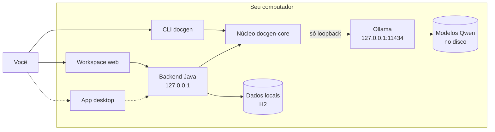

<div align="center">

# DocGen

**Seu assistente local e gratuito.**

Sua IA. Seu computador. Suas regras.

[](https://github.com/brunocorreia-dev/Docgen/actions/workflows/ci.yml)


</div>

> [!WARNING]
> **O DocGen está sendo reconstruído para virar um aplicativo desktop, e esse app ainda não está pronto para uso.**
> O que funciona hoje é voltado a desenvolvedores: uma linha de comando que gera documentação de repositórios e um
> workspace web local, os dois usando uma IA que roda no seu computador. Ainda não há instalador do app nem versão 3.0
> publicada. Acompanhe o andamento no [roadmap](docs/desktop/ROADMAP.md).

## O que é o DocGen

Rodar uma IA no próprio computador ainda é coisa de quem domina o terminal: é preciso instalar um servidor de modelos,
escolher entre dezenas de versões sem saber se a máquina aguenta, baixar arquivos de vários gigabytes por linha de
comando e conversar numa janela de texto.

O DocGen quer tornar isso simples. A proposta é um aplicativo que você instala como qualquer outro. Ao abrir, ele
verifica o hardware do seu computador, recomenda um modelo de IA **Qwen** que caiba nele, baixa esse modelo com a ajuda
do [Ollama](https://ollama.com) e deixa você conversar. Tudo roda na sua máquina: suas conversas e seus arquivos não
vão para a nuvem.

O app serve para o dia a dia (tirar dúvidas, escrever textos, estudar, organizar ideias) e também para quem desenvolve
software. Para esse público, o mesmo chat ganha ferramentas para explicar código, analisar requisitos e gerar
documentação como `README.md` e `ARCHITECTURE.md`.

## Princípios

- **Local primeiro.** Nada sai do seu computador. A única exceção é o download de um modelo, feito pelo próprio Ollama
  e só quando você pede. Hoje isso é feito com o comando `ollama pull`; no app, será um clique numa tela que avisa de
  onde vem o download e qual o tamanho.
- **Gratuito.** Sem assinatura e sem recurso pago.
- **Código aberto.** O código é público no GitHub. A licença ainda não foi definida (veja [Licença](#licença)).
- **Privacidade.** Sem telemetria, sem analytics e sem carregar nada de fora na interface.
- **Sem terminal para quem só quer usar.** Essa é a meta do app desktop. Hoje o DocGen ainda é usado pela linha de
  comando.
- **Segurança e transparência.** O que não pode ser verificado com segurança falha em vez de seguir adiante, e o status
  de cada recurso fica claro neste README.

## Funcionalidades

| Funcionalidade | Descrição | Status |
|---|---|---|
| Documentação de repositórios pela CLI | Gera `README.md` e `ARCHITECTURE.md` de um repositório local com um modelo do Ollama (padrão: `qwen2.5-coder:7b`). | ✅ Disponível |
| Janela de contexto explícita | Cada pedido informa ao Ollama o contexto necessário. Se o conteúdo não couber no modelo, a geração para antes de enviar qualquer coisa. | ✅ Disponível |
| Inspeção antes de gerar | `--dry-run` mostra os arquivos escolhidos e `--preview-prompt` grava o prompt exato, sem chamar a IA. | ✅ Disponível |
| Workspace web para desenvolvedores | Interface local em `127.0.0.1` com projetos, anexos PDF, plano de arquitetura com revisão humana, diagrama e geração, edição e exportação de documentos. Ainda exige usuário e senha por variável de ambiente; isso é temporário. | ✅ Disponível |
| Proteções de segurança | Leitura segura de repositórios, redação de segredos, isolamento contra *prompt injection*, saída restrita a Markdown passivo e IA acessada só em loopback. | ✅ Disponível |
| App desktop sem login | Abrir o DocGen como um aplicativo, sem senha nem variáveis de ambiente, com instância única e encerramento limpo. | 🚧 Em desenvolvimento: desenho aprovado, implementação ainda não começou |
| Diagnóstico de hardware | Detectar CPU, memória, GPU e espaço em disco, mostrando "não detectado" quando não for possível. | 🗺️ Planejado |
| Recomendação de modelos Qwen | Indicar quais modelos o seu computador aguenta, e por quê. | 🗺️ Planejado |
| Gerenciador de modelos | Baixar com progresso real, cancelar, remover e testar modelos. | 🗺️ Planejado |
| Bloqueio de modelos de nuvem do Ollama | Impedir o uso de modelos que o Ollama executa fora do computador. | 🗺️ Planejado |
| Chat local | Conversas com respostas em tempo real, histórico salvo no computador e botão de parar. | 🗺️ Planejado |
| Anexos no chat | PDF e Markdown na conversa, tratados como dado não confiável. | 🗺️ Planejado |
| Ferramentas de engenharia no app | Planejamento de arquitetura e documentação dentro do app, a partir do chat. | 🗺️ Planejado |
| Instaladores | `.deb`, `.rpm`, `.msi` ou `.exe` e `.dmg`. | 🗺️ Planejado |
| Site oficial | Apresentação, downloads e tutoriais. Hoje existe só uma página provisória em `site/`. | 🗺️ Planejado |

## Como funciona



Linhas contínuas mostram o que já existe; linhas tracejadas, o que está planejado (o app desktop). Não há nenhum serviço
de nuvem no caminho: o DocGen conversa só com o Ollama no endereço local `127.0.0.1`.

## Roadmap

| Fase | Entrega | Status |
|---|---|---|
| 0 | Auditoria do projeto, plano de execução e decisões de arquitetura (ADRs). | ✅ Concluída |
| 1 | Somente local: só o Ollama, sem provedor remoto, e correção do corte silencioso de prompts longos (`num_ctx` explícito, com falha fechada). | ✅ Concluída |
| 2 | Launcher desktop sem login: instância única, token de lançamento e dados em diretórios próprios de cada sistema. | 🚧 Em andamento: desenho aprovado, implementação ainda não começou |
| 3 | Ollama, diagnóstico de hardware, catálogo e recomendação de modelos Qwen. | 🗺️ Planejada |
| 4 | Chat local com respostas em tempo real. | 🗺️ Planejada |
| 5 | Anexos PDF e Markdown no chat. | 🗺️ Planejada |
| 6 | Ferramentas de engenharia integradas ao chat. | 🗺️ Planejada |
| 7 | Instaladores para Linux, Windows e macOS. | 🗺️ Planejada |
| 8 | Site oficial. | 🗺️ Planejada |
| 9 | Documentação final e validação ponta a ponta. | 🗺️ Planejada |

Detalhes no [roadmap completo](docs/desktop/ROADMAP.md) e nas decisões de arquitetura:
[shell desktop](docs/adr/0001-shell-desktop.md),
[autenticação por token de lançamento](docs/adr/0002-autenticacao-por-token-de-lancamento.md) e
[somente local](docs/adr/0003-somente-local.md).

Antes do realinhamento, o DocGen teve uma CLI de documentação de repositórios (v1) e um workspace web com API REST
(v2.0.0, publicada em 2026-10-22). As mudanças de cada versão estão no [CHANGELOG](CHANGELOG.md).

## Para desenvolvedores: usar hoje

O que existe hoje é usado pelo terminal. Não há release da versão 3.0: a última release publicada (v2.0.0) ainda tem o
provedor remoto e o comportamento antigo, então compile pelo código-fonte.

### Pré-requisitos

| Requisito | Detalhe |
|---|---|
| Java 21 ou mais novo | Para compilar e executar. |
| Maven 3.9 ou mais novo | Para compilar. |
| Ollama | Em execução em `127.0.0.1:11434`. Download oficial: [ollama.com/download](https://ollama.com/download). |
| Modelo `qwen2.5-coder:7b` | Instalado no Ollama com `ollama pull qwen2.5-coder:7b` (cerca de 4,7 GB, segundo a [biblioteca do Ollama](https://ollama.com/library/qwen2.5-coder)). O DocGen nunca baixa modelos sozinho. |
| Node.js 20 ou mais novo | Só para os testes do frontend. |

### Compilar

```bash
git clone https://github.com/brunocorreia-dev/Docgen.git
cd Docgen
mvn -B verify
```

O build roda os testes e gera `target/docgen.jar` (CLI) e `docgen-api/target/docgen-api.jar` (workspace web).

### Usar a CLI

```bash
mkdir -p ./generated && chmod 700 ./generated

# Mostra quais arquivos seriam lidos, sem chamar a IA
java -jar target/docgen.jar --dry-run /caminho/do/repositorio

# Grava em ./generated o prompt exato, sem chamar a IA
java -jar target/docgen.jar --preview-prompt --output ./generated /caminho/do/repositorio

# Gera README.md e ARCHITECTURE.md com o Ollama
java -jar target/docgen.jar --output ./generated /caminho/do/repositorio
```

- O diretório de saída precisa existir e não pode ser gravável por outros usuários. Arquivos existentes só são
  substituídos com `--force`.
- Para usar outro modelo já instalado, acrescente `--model <nome>`.
- Se o modelo não estiver instalado, a CLI explica como instalá-lo e encerra sem baixar nada.
- Se o repositório não couber no contexto do modelo, a geração para antes de qualquer envio e sugere reduzir a seleção
  com `--include-ext` ou `.docgenignore`.

Todas as opções, as regras de seleção de arquivos e os limites estão em [docs/cli.md](docs/cli.md).

### Subir o workspace web

```bash
export DOCGEN_API_USERNAME="$USER"
read -rs -p "Senha (12+ caracteres): " DOCGEN_API_PASSWORD; echo
export DOCGEN_API_PASSWORD
./docgen-server
```

Abra `http://127.0.0.1:8080` e entre com esse usuário e essa senha.

> [!NOTE]
> O login por usuário e senha é **temporário**. A Fase 2 o substitui por um launcher que abre o app já autenticado
> ([ADR 0002](docs/adr/0002-autenticacao-por-token-de-lancamento.md)).

Variáveis de ambiente, fluxo de trabalho e a API REST estão em [docs/api.md](docs/api.md).

## Segurança e privacidade

O que já está em `main`:

- O repositório é lido só por `SecureDirectoryStream`, sem seguir links simbólicos e com limites de tamanho.
- Arquivos sensíveis (`.env*`, chaves privadas, credenciais) nunca são lidos, e `.gitignore` e `.docgenignore` são
  respeitados.
- O `SecretRedactor` remove tokens e credenciais conhecidos do prompt e da resposta.
- Conteúdo de repositórios e de PDFs entra no prompt como dado não confiável, entre delimitadores, com as regras
  reafirmadas depois do bloco.
- A resposta só é gravada se for Markdown passivo (sem HTML, imagens ou scripts), e o par README e ARCHITECTURE é
  gravado de forma transacional.
- O Ollama é acessado só em `127.0.0.1`, sem resolução de nome, sem proxy e sem seguir redirecionamentos. Não existe
  provedor remoto nem chave de API.
- O contexto do modelo é dimensionado para cada pedido. Se o prompt não couber, a operação falha em vez de ser cortada
  em silêncio.
- Um teste de arquitetura reprova o build se surgir no código uma URL remota, outro cliente de rede ou outro provedor.
- O workspace escuta só em `127.0.0.1`, confere o cabeçalho `Host`, não libera CORS e usa uma política de segurança de
  conteúdo (CSP) estrita.

Limitações conhecidas:

- **Modelos de nuvem do Ollama ainda não são bloqueados.** O bloqueio vem na Fase 3. Até lá, use modelos locais ou
  ative o modo só local do Ollama (`OLLAMA_NO_CLOUD=1`, conforme a [FAQ do Ollama](https://docs.ollama.com/faq)).
- A estimativa de contexto é calibrada para a família Qwen. Para outras famílias de modelo, é melhor esforço.
- A redação de segredos funciona por padrões e não reconhece todos os formatos.
- As defesas contra *prompt injection* reduzem o risco, mas não o eliminam.
- A IA produz rascunhos: revise a documentação antes de publicar.
- O workspace ainda usa login por usuário e senha e não tem HTTPS (o tráfego fica no endereço local).

Os detalhes estão em [SECURITY.md](SECURITY.md). Para relatar uma vulnerabilidade, abra um security advisory privado
no GitHub antes de qualquer divulgação.

## Arquitetura do repositório

| Caminho | Conteúdo |
|---|---|
| `docgen-core` | Núcleo reutilizável: varredura segura, prompts, cliente do Ollama, validação e planejamento de arquitetura. |
| `docgen-cli` | Linha de comando (`target/docgen.jar`). |
| `docgen-api` | Backend Spring Boot em loopback, com dados locais (H2 e Flyway); serve o workspace. |
| `docgen-web` | Interface web sem framework e sem build (HTML, CSS e ES Modules). |
| `site/` | Página estática provisória publicada na Vercel. |
| `docs/` | Roadmap, decisões de arquitetura e referências da [CLI](docs/cli.md), da [API](docs/api.md) e do [desenvolvimento](docs/development.md). |

A descrição de cada componente está em [ARCHITECTURE.md](ARCHITECTURE.md).

## Contribuindo

```bash
mvn -B verify                                   # testes Java e SBOMs
node --test docgen-web/src/test/js/*.test.mjs   # testes do frontend
```

- Crie uma branch a partir de `main` e abra um pull request.
- O PR só entra com a CI verde (testes com Temurin 21, CodeQL, OSV-Scanner e revisão de dependências) e por merge
  commit.
- As mensagens de commit seguem o padrão Conventional Commits, em
  português (por exemplo, `fix(cli): valida o tamanho dos prompts antes de anunciar a geração`).

Testes, CI e o processo de release estão descritos em [docs/development.md](docs/development.md). Sugestões e
problemas podem ser enviados pelas [issues](https://github.com/brunocorreia-dev/Docgen/issues).

## Licença

O repositório ainda não tem um arquivo `LICENSE`, então nenhuma licença de código aberto foi concedida até agora.
Definir a licença é uma pendência registrada.

## Autor

Desenvolvido por **Bruno Correia**: [github.com/brunocorreia-dev](https://github.com/brunocorreia-dev).
