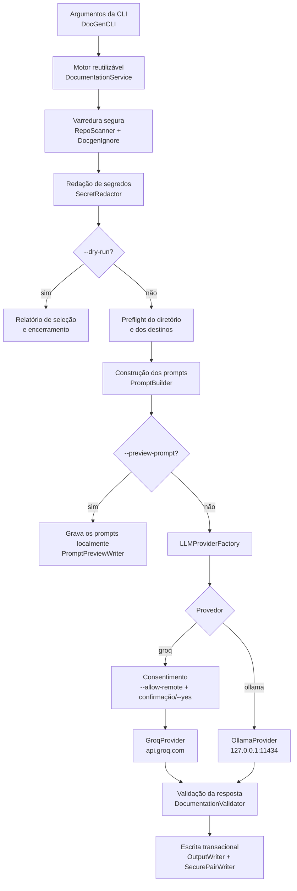

<div align="center">

# DocGen

**CLI em Java 21 que analisa um repositório de código e gera `README.md` e `ARCHITECTURE.md` com modelos de linguagem, com segurança como padrão.**

[](https://github.com/brunocorreia-dev/Docgen/actions/workflows/ci.yml)


[Visão geral](#visão-geral) ·
[Funcionalidades](#principais-funcionalidades) ·
[Instalação](#instalação) ·
[Uso](#guia-de-utilização) ·
[CLI](#referência-completa-da-cli) ·
[Segurança](#segurança) ·
[Arquitetura](#arquitetura-do-projeto) ·
[Qualidade](#testes-e-qualidade)

</div>

---

## Sumário

- [Visão geral](#visão-geral)
- [Principais funcionalidades](#principais-funcionalidades)
- [Tecnologias utilizadas](#tecnologias-utilizadas)
- [Como o DocGen funciona](#como-o-docgen-funciona)
- [Pré-requisitos](#pré-requisitos)
- [Instalação](#instalação)
- [Guia de utilização](#guia-de-utilização)
- [Referência completa da CLI](#referência-completa-da-cli)
- [Segurança](#segurança)
- [Configuração da análise](#configuração-da-análise)
- [Arquitetura do projeto](#arquitetura-do-projeto)
- [Testes e qualidade](#testes-e-qualidade)
- [Distribuição e integridade](#distribuição-e-integridade)
- [Limitações conhecidas](#limitações-conhecidas)
- [Evolução do projeto](#evolução-do-projeto)
- [Autor](#autor)

## Visão geral

O **DocGen** é uma aplicação de linha de comando que lê um repositório local, seleciona os arquivos de texto relevantes e usa um modelo de linguagem (LLM) para redigir dois documentos:

| Documento | Conteúdo |
|---|---|
| `README.md` | Documentação geral do projeto. |
| `ARCHITECTURE.md` | Documentação da arquitetura de software. |

**O problema.** Documentação costuma ficar desatualizada ou nem chegar a ser escrita. Redigir um primeiro rascunho a partir do código é um trabalho repetitivo, que um LLM consegue acelerar. Ao mesmo tempo, enviar um repositório para um modelo traz riscos reais: vazamento de credenciais, envio não intencional de arquivos privados, prompt injection embutido no próprio código e respostas com conteúdo ativo indesejado.

**A abordagem.** O DocGen automatiza a geração do rascunho e trata o repositório como **dado não confiável** do início ao fim. A IA fica restrita a uma etapa bem delimitada do pipeline: recebe um retrato do repositório com limites rígidos de tamanho, segredos redigidos e conteúdo isolado por delimitadores. A resposta só é gravada em disco depois de passar por validações.

**Cenários de uso:**

- gerar um primeiro rascunho de documentação para projetos sem README;
- revisar ou atualizar a documentação de projetos existentes;
- documentar código de forma totalmente local, com Ollama, sem enviar dados para fora da máquina;
- inspecionar com precisão o que seria enviado a um provedor antes de qualquer comunicação remota.

> [!IMPORTANT]
> O DocGen produz **rascunhos**. A documentação gerada por IA pode conter imprecisões e deve ser revisada por uma pessoa antes de ser publicada.

## Principais funcionalidades

| Funcionalidade | Descrição |
|---|---|
| Análise automatizada de repositórios | Varredura determinística e limitada da árvore de arquivos, com seleção de arquivos de texto suportados. |
| Geração de README e arquitetura | Uma requisição para o `README.md` e outra para o `ARCHITECTURE.md`. |
| Integração com Groq | Provedor remoto padrão (`https://api.groq.com`), autenticado por `GROQ_API_KEY`. Modelo padrão: `llama-3.3-70b-versatile`. |
| Integração com Ollama | Provedor local em `http://127.0.0.1:11434`, sem proxy do sistema. Modelo padrão: `llama3.2`. |
| Execução local | Com Ollama, todo o processamento permanece na máquina. |
| Modo de simulação (`--dry-run`) | Lista os arquivos incluídos e excluídos e encerra sem contatar nenhum provedor. |
| Pré-visualização de prompts (`--preview-prompt`) | Grava localmente os prompts exatos que seriam enviados, sem contatar nenhum provedor. |
| Exclusão de arquivos sensíveis | `.env*`, chaves privadas, keystores, `credentials*`, `*secret*`, contas de serviço e similares nunca são lidos. |
| Redação de segredos | Tokens conhecidos e credenciais são removidos do conteúdo e dos caminhos antes da montagem do prompt e novamente na resposta. |
| Respeito ao `.gitignore` | Arquivos `.gitignore` da raiz e aninhados são aplicados com semântica compatível com o Git. |
| Suporte a `.docgenignore` | Arquivo de exclusão adicional na raiz, apenas para exclusões. |
| Allowlist de extensões | `--include-ext` restringe a seleção a extensões específicas. |
| Controle de sobrescrita | Arquivos existentes só são substituídos com `--force`. |
| Consentimento para envio remoto | Groq exige `--allow-remote`, além de confirmação interativa ou `--yes`. |
| Validação da documentação gerada | Resposta completa, redigida novamente, limitada em tamanho e restrita a Markdown passivo. |
| Escrita transacional segura | Os dois arquivos são publicados como um par, com reversão em caso de falha. |

## Tecnologias utilizadas

| Tecnologia | Versão | Responsabilidade |
|---|---|---|
| Java | 21 | Linguagem e runtime. Usa `java.net.http.HttpClient` e `SecureDirectoryStream` (NIO). |
| Maven | 3.9+ | Build, testes e empacotamento. |
| [picocli](https://picocli.info/) | 4.7.7 | Parsing dos argumentos da CLI, `--help` e `--version`. |
| Jackson Databind | 2.21.5 | Serialização e desserialização JSON nas APIs dos provedores. |
| JUnit Jupiter | 6.1.0 | Testes automatizados. |
| maven-shade-plugin | 3.6.2 | Gera o JAR executável `target/docgen.jar`, com as dependências incluídas. |
| cyclonedx-maven-plugin | 2.9.2 | Gera o SBOM CycloneDX 1.6 (`target/docgen.cdx.json`) na fase `verify`. |
| Groq API | — | Provedor de LLM remoto. |
| Ollama | — | Provedor de LLM local. |
| GitHub Actions | — | CI, varreduras de segurança e pipeline de release. |
| CodeQL | — | Análise estática com a suíte `security-extended`. |
| OSV-Scanner | — | Bloqueio de dependências com vulnerabilidades conhecidas. |
| Dependency Review | — | Revisão das mudanças de dependências em pull requests. |
| Dependabot | — | Atualização de dependências e das actions fixadas por SHA. |
| Sigstore / Cosign | — | Assinatura keyless dos artefatos de release e sua verificação. |

## Como o DocGen funciona

1. **Argumentos da CLI**: o picocli interpreta as opções em `DocGenCLI` e cria um `DocumentationRequest`.
2. **Orquestração reutilizável**: o `DocumentationService` executa o pipeline sem depender de terminal e devolve um `DocumentationResult` estruturado.
3. **Leitura do repositório**: o `RepoScanner` percorre a árvore apenas por meio de handles `SecureDirectoryStream`, sem seguir symlinks.
4. **Regras de exclusão**: exclusões internas, `.gitignore`, `.docgenignore` e `--include-ext`.
5. **Dados sensíveis**: arquivos sensíveis são ignorados e o `SecretRedactor` redige segredos no conteúdo e nos caminhos.
6. **Preflight**: o diretório de saída e os arquivos de destino são validados *antes* da construção dos prompts.
7. **Construção dos prompts**: o `PromptBuilder` isola o conteúdo como dado não confiável.
8. **Provedor**: o `LLMProviderFactory` cria o `GroqProvider` ou o `OllamaProvider`.
9. **Validação das respostas**: marcador de conclusão, nova redação e contrato de Markdown passivo (`DocumentationValidator`).
10. **Escrita segura**: o `OutputWriter` e o `SecurePairWriter` revalidam as condições e publicam o par de arquivos de forma transacional.



## Pré-requisitos

| Requisito | Detalhes |
|---|---|
| Java 21+ | Necessário para executar e compilar. |
| Maven 3.9+ | Necessário apenas para compilar a partir do código-fonte. |
| Provedor de LLM | **Groq**: chave na variável de ambiente `GROQ_API_KEY`. **Ollama**: serviço em execução em `http://127.0.0.1:11434`, com o modelo desejado disponível. |
| Sistema de arquivos seguro | O provedor de sistema de arquivos do Java precisa implementar `SecureDirectoryStream`. Caso contrário, o DocGen falha (fail-closed) em vez de usar uma alternativa insegura. |
| Diretório de saída | Precisa **existir previamente**, ser confiável e não compartilhado. Em sistemas POSIX, não pode ter permissão de escrita para grupo ou outros usuários. |

> [!NOTE]
> Como a varredura e a escrita dependem de `SecureDirectoryStream`, sistemas de arquivos que não oferecem esse recurso são rejeitados. O DocGen nunca cria o diretório de saída por conta própria.

## Instalação

### Instalação por release

```bash
curl -fsSL https://raw.githubusercontent.com/brunocorreia-dev/Docgen/main/install.sh | sh
```

O script `install.sh`:

- exige Java instalado e `curl` ou `wget`, e aceita somente URLs HTTPS;
- baixa `docgen.jar` e `docgen.jar.sha256` da release mais recente de `brunocorreia-dev/Docgen`;
- **sempre** verifica o checksum SHA-256, que é interpretado de forma estrita;
- se o `cosign` estiver instalado, verifica as assinaturas Sigstore do JAR e do checksum, vinculadas ao workflow `release.yml` em uma tag;
- instala `docgen.jar` e o wrapper `docgen` em `$HOME/.local/bin`, diretório que pode ser alterado com `INSTALL_DIR`.

| Variável | Efeito |
|---|---|
| `INSTALL_DIR` | Diretório de instalação (padrão: `$HOME/.local/bin`). |
| `DOCGEN_REQUIRE_SIGNATURE=1` | Torna a verificação com cosign obrigatória. |
| `DOCGEN_SKIP_SIGNATURE=1` | Ignora explicitamente a verificação de assinatura e mantém só o checksum. |

As duas últimas variáveis são mutuamente exclusivas. Sem o cosign, o instalador continua apenas com o checksum e exibe um aviso.

### Compilação pelo código-fonte

```bash
# 1. Obter o repositório
git clone https://github.com/brunocorreia-dev/Docgen.git
cd Docgen

# 2. Executar os testes
mvn -B test

# 3. Compilar e gerar o JAR executável (target/docgen.jar)
mvn -B package

# 4. Executar
java -jar target/docgen.jar --help
```

O repositório também inclui o script `./docgen`, que executa `target/docgen.jar` e repassa todos os argumentos. Para usá-lo, rode `mvn package` antes.

```bash
./docgen --version
```

## Guia de utilização

Os exemplos usam `java -jar target/docgen.jar`. Se você instalou pela release, substitua por `docgen`.

### 1. Preparar o diretório de saída

O DocGen não cria diretórios. Crie um diretório privado uma única vez:

```bash
mkdir -p ./generated
chmod 700 ./generated
```

### 2. Análise preliminar com `--dry-run`

Mostra quais arquivos seriam incluídos ou excluídos. Nada é enviado a nenhum provedor:

```bash
java -jar target/docgen.jar --dry-run /caminho/do/repositorio
```

Use este passo sempre que analisar um repositório pela primeira vez.

### 3. Pré-visualizar os prompts

Grava em `./generated` os prompts exatos que uma execução real enviaria (`docgen-readme.prompt.txt` e `docgen-architecture.prompt.txt`). Nenhum provedor é contatado:

```bash
java -jar target/docgen.jar --preview-prompt --output ./generated /caminho/do/repositorio
```

Os arquivos recebem permissões restritas ao proprietário quando há atributos POSIX disponíveis. Pré-visualizações existentes só são substituídas com `--force`.

### 4. Gerar com Groq (remoto)

```bash
export GROQ_API_KEY="..."
java -jar target/docgen.jar --allow-remote --output ./generated /caminho/do/repositorio
```

Em um terminal real, o DocGen pede confirmação (y/N) antes do envio. Em CI ou em outro ambiente sem console, adicione `--yes`:

```bash
java -jar target/docgen.jar --allow-remote --yes --output ./generated /caminho/do/repositorio
```

> [!WARNING]
> Sem `--allow-remote`, nenhuma requisição ao Groq é feita. `--yes` **não** substitui `--allow-remote`: as duas condições precisam estar presentes.

### 5. Gerar com Ollama (local)

```bash
java -jar target/docgen.jar --provider ollama --model llama3.2 --output ./generated /caminho/do/repositorio
```

O Ollama não exige `--allow-remote`, porque a comunicação ocorre apenas com o loopback IPv4 local.

### 6. Sobrescrever arquivos existentes

`README.md` e `ARCHITECTURE.md` existentes só são substituídos com `--force`:

```bash
java -jar target/docgen.jar --allow-remote --force --output ./generated /caminho/do/repositorio
```

### 7. Selecionar extensões

Restringe a análise a extensões específicas. A opção apenas reduz a seleção padrão e nunca reinclui arquivos sensíveis:

```bash
java -jar target/docgen.jar --dry-run --include-ext java,md,xml /caminho/do/repositorio
```

### 8. Escolher o modelo

```bash
# Groq com um modelo específico
java -jar target/docgen.jar --allow-remote --model <nome-do-modelo> --output ./generated /caminho/do/repositorio

# Ollama com outro modelo disponível localmente
java -jar target/docgen.jar --provider ollama --model <nome-do-modelo> --output ./generated /caminho/do/repositorio
```

Sem `--model`, os padrões são `llama-3.3-70b-versatile` (Groq) e `llama3.2` (Ollama).

## Referência completa da CLI

```text
docgen [opções] [<repositório>]
```

| Parâmetro | Tipo | Descrição | Exemplo |
|---|---|---|---|
| `<repositório>` | Posicional, opcional | Diretório a ser analisado. Padrão: diretório atual (`.`). | `/caminho/do/repo` |
| `--provider <groq\|ollama>` | Opcional | Provedor de LLM. Padrão: `groq`. | `--provider ollama` |
| `--model <nome>` | Opcional, depende do provedor | Modelo. Padrões: `llama-3.3-70b-versatile` (Groq) e `llama3.2` (Ollama). | `--model llama3.2` |
| `--allow-remote` | **Obrigatório com Groq** | Autoriza o envio de conteúdo para a API remota. | `--allow-remote` |
| `-y`, `--yes` | Groq, obrigatório sem console | Dispensa a confirmação interativa. Não substitui `--allow-remote`. | `--yes` |
| `--dry-run` | Opcional | Lista os arquivos incluídos e excluídos e encerra sem contatar provedores. | `--dry-run` |
| `--preview-prompt` | Opcional | Grava os prompts exatos no diretório de saída sem contatar provedores. | `--preview-prompt` |
| `--include-ext <exts>` | Opcional | Allowlist de extensões separadas por vírgula. Apenas restringe a seleção. | `--include-ext java,md,xml` |
| `-o`, `--output <dir>` | Opcional | Diretório de saída, que precisa existir. Padrão: diretório atual (`.`). | `-o ./generated` |
| `--force` | Opcional | Permite sobrescrever documentação ou pré-visualizações existentes. | `--force` |
| `-h`, `--help` | Opcional | Exibe a ajuda. | `--help` |
| `-V`, `--version` | Opcional | Exibe a versão (`docgen 1.0.0`). | `--version` |

| Variável de ambiente | Uso |
|---|---|
| `GROQ_API_KEY` | Chave da API do Groq. **Só** é lida da variável de ambiente, nunca de argumentos da CLI. |

## Segurança

A segurança é um requisito central do DocGen. O detalhamento completo, incluindo a lista exata de dados enviados, está em [SECURITY.md](SECURITY.md).

### Princípio fail-closed

Quando uma condição não pode ser verificada com segurança, como um sistema de arquivos sem `SecureDirectoryStream`, uma regra de ignore ambígua ou um limite excedido, o DocGen **falha ou exclui** o item. Ele nunca recorre a uma alternativa permissiva.

### Mecanismos de proteção

| Área | Proteção |
|---|---|
| **Credenciais** | `GROQ_API_KEY` só é lida do ambiente, nunca de argumentos. Ela vai apenas no cabeçalho de autorização para `https://api.groq.com`. |
| **Arquivos sensíveis** | `.env*`, chaves privadas, keystores, `credentials*`, `*secret*`, contas de serviço e lock files são excluídos antes de qualquer allowlist e **não podem ser reincluídos**, nem com `--include-ext`. Os nomes desses arquivos nunca entram no prompt. |
| **Redação de segredos** | Remove formatos comuns de tokens (AWS, Google, GitHub, GitLab, Slack, Stripe, SendGrid, Twilio, npm, PyPI, Hugging Face, DigitalOcean, Shopify, Azure, JWTs), blocos de chave privada, credenciais embutidas em URLs, cabeçalhos de autorização e atribuições de credenciais. A redação é aplicada ao arquivo completo antes do truncamento, a cada caminho e metadado visível no prompt e novamente sobre a resposta do modelo. |
| **Prompt injection** | O conteúdo do repositório é delimitado como dado não confiável, tags que imitam os delimitadores são neutralizadas e as regras de segurança são reafirmadas após o bloco de conteúdo. |
| **Symlinks** | A varredura e a escrita usam operações relativas a handles (`SecureDirectoryStream` com `NOFOLLOW_LINKS`). Symlinks na raiz, em ancestrais, diretórios, arquivos, arquivos de ignore e no caminho de saída nunca são seguidos. |
| **Escrita de arquivos** | O diretório de saída precisa existir, ser confiável e não compartilhado (em POSIX, sem escrita para grupo ou outros). A saída é preparada em canais privados `CREATE_NEW`, com verificação de identidade e digest. O par é publicado sem substituir um destino que surja concorrentemente e, em caso de falha, os originais são restaurados. |
| **Preflight** | Diretório inválido ou conflito de sobrescrita falham *antes* da construção dos prompts e da inicialização do provedor. A escrita final repete as validações para mitigar condições de corrida. |
| **Comunicação remota** | Endpoints fixos: Groq em `https://api.groq.com`; Ollama em `http://127.0.0.1:11434`, com proxies do sistema desativados. O Groq faz no máximo três tentativas por requisição após erros de limite de taxa ou de servidor. |
| **Consentimento** | Groq exige `--allow-remote`. Execuções interativas pedem confirmação y/N, e execuções sem console exigem `--yes`. Nenhuma das flags autoriza o envio sozinha. |
| **Permissões** | Pré-visualizações de prompt usam permissões restritas ao proprietário quando há atributos POSIX disponíveis. |
| **Respostas dos modelos** | Corpos de erro são descartados e a leitura é limitada. É obrigatório um marcador de conclusão bem-sucedida (`finish_reason` no Groq, marcador terminal no Ollama). O corpo NDJSON do Ollama é limitado a 16 MiB. A saída é limitada a 2.000.000 caracteres, passa por verificação Unicode e de caracteres de controle, precisa começar com um H1 e usar Markdown passivo: sem HTML bruto, imagens, autolinks ou esquemas de link que não sejam web ou relativos. |
| **Inspeção** | `--dry-run` e `--preview-prompt` permitem auditar a seleção e os prompts sem cruzar nenhuma fronteira de rede. |

### Limitações dos mecanismos de proteção

- A redação de segredos é **baseada em padrões**. Ela não reconhece formatos proprietários ou sem prefixo, segredos divididos em várias linhas nem valores codificados ou ofuscados.
- As defesas contra prompt injection **reduzem o risco, mas não o eliminam**.
- A validação garante a **forma** da saída, não a **veracidade** do conteúdo.
- O Java NIO portátil não distingue hardlinks ou bind mounts de inodes legítimos. Não analise repositórios graváveis por usuários locais não confiáveis.
- A escrita do par é reversível em caso de falha, mas não funciona como um journal contra quedas abruptas do processo ou do sistema operacional.

> [!CAUTION]
> Os mecanismos automatizados reduzem riscos, mas **não substituem a revisão humana**. Revise a documentação gerada antes de publicá-la e use `--preview-prompt` sempre que houver dúvida sobre o conteúdo enviado.

Vulnerabilidades devem ser reportadas por meio de um security advisory privado ou diretamente ao proprietário do repositório, antes de qualquer divulgação pública.

## Configuração da análise

Os controles abaixo **apenas restringem** a seleção. Nenhum deles amplia a varredura além das exclusões internas.

| Ordem | Controle | Comportamento |
|---|---|---|
| 1 | **Exclusões internas** | Diretórios de agentes, IDEs e build (como `.git`), snapshots de pré-visualização (`docgen-*.prompt.txt`) e caminhos sensíveis. São sempre aplicadas. |
| 2 | **`.gitignore`** | Arquivos da raiz e aninhados, com escopo. Suporta negação ordenada, BOM, `*`, `?`, intervalos ASCII entre colchetes e segmentos `**`, com correspondência em bytes UTF-8 compatível com o Git. |
| 3 | **`.docgenignore`** | Somente na raiz e somente para exclusão (detalhes abaixo). |
| 4 | **`--include-ext`** | Allowlist opcional de extensões que restringe o conjunto suportado. |
| 5 | **`--dry-run`** | Relatório local da seleção, sem contato com provedores. |

### `.gitignore`: comportamento conservador

- Classes POSIX, classes aninhadas ou não ASCII entre colchetes e padrões não NFC **falham** em vez de serem aproximados.
- Como o `core.ignoreCase` do repositório não é considerado confiável, são avaliados os estados sensível e insensível a maiúsculas (ASCII). Um caminho excluído por qualquer um deles permanece excluído.
- Um filho não pode ser reincluído enquanto o diretório pai estiver ignorado, e a negação de um diretório não cancela a exclusão mais específica de um filho.
- Nomes de arquivos de ignore com capitalização ambígua e caracteres de controle ambíguos falham. Caminhos não NFC ou com decodificação ambígua são excluídos.

### `.docgenignore`

```text
# Comentários (linhas iniciadas por #) e linhas em branco são ignorados.

# Sem "/": corresponde em qualquer profundidade
notes.md
*.sql

# Com "/": relativo à raiz
docs/internal.md

# "/" final: exclui o diretório e todo o seu conteúdo
docs/
```

A negação (`!`) é **rejeitada**: a varredura falha em vez de ignorar a linha silenciosamente.

### Limites da varredura

| Limite | Valor |
|---|---|
| Entradas descobertas | 4.096 |
| Arquivos tentados | 512 |
| Profundidade de diretórios | 64 níveis |
| Caracteres por caminho visível no prompt | 512 |
| Leitura por arquivo | 256 KiB |
| Caracteres de prompt por arquivo | 20.000 |
| Caracteres de conteúdo no total | 120.000 |
| Tamanho de cada arquivo de ignore | 64 KiB |
| Regras ordenadas | 512 |
| Globs compilados | 2.048 |
| Matchers de segmento | 8.192 |
| Estados NFA (ambos os modos de capitalização) | 250.000 |

A árvore de arquivos e os metadados de arquivos ignorados têm orçamentos próprios, e há também um orçamento global de trabalho de correspondência. Quando um limite é excedido, o fato é reportado ou a execução falha. Isso nunca resulta em alocação ilimitada, prompt ilimitado ou backtracking de expressões regulares.

### O que vai para o provedor

Em cada uma das duas requisições: o conteúdo redigido dos arquivos incluídos, os caminhos relativos redigidos (também na forma de árvore limitada) e os nomes e motivos, redigidos e limitados, dos arquivos ignorados por limite de tamanho. **Nomes de arquivos sensíveis, ignorados, não suportados ou filtrados pela allowlist nunca entram no prompt.**

## Arquitetura do projeto

O DocGen mantém a interface CLI separada de um **motor reutilizável** no pacote `com.docgen`:

```text
DocGenCLI
  -> DocumentationRequest
  -> DocumentationService
      -> RepoScanner (+ DocgenIgnore, SecretRedactor)
      -> [--dry-run encerra aqui]
      -> preflight seguro de saída/pré-visualização
      -> PromptBuilder
      -> [--preview-prompt encerra aqui, antes de qualquer provedor existir]
      -> LLMProviderFactory
          -> GroqProvider | OllamaProvider
      -> DocumentationValidator
      -> OutputWriter (revalida antes da publicação)
  -> DocumentationResult
```

| Responsabilidade | Classes |
|---|---|
| Interface de terminal | `DocGenCLI` |
| Contratos e orquestração reutilizável | `DocumentationRequest`, `DocumentationResult`, `DocumentationService` |
| Leitura do repositório | `RepoScanner`, `RepoContext` |
| Filtros e segurança | `DocgenIgnore`, `SecretRedactor`, `SafeText` |
| Construção dos prompts | `PromptBuilder` |
| Integração com provedores | `LLMProvider`, `LLMProviderFactory`, `GroqProvider`, `OllamaProvider`, `HttpExchange`, `DirectProxySelector` |
| Validação | `DocumentationValidator` |
| Persistência | `OutputWriter`, `PromptPreviewWriter`, `SecurePairWriter` |

O `LLMProvider` abstrai os provedores. Cada implementação declara `isRemote()` e `describeDestination()`, informações que alimentam o callback explícito de consentimento do serviço e os avisos da CLI. `--yes` é interpretado somente pela CLI; não faz parte do contrato reutilizável. O `DocumentationResult` não expõe caminhos absolutos nem o conteúdo-fonte bruto, enquanto o `RepoContext` interno separa exclusões visíveis no prompt das exclusões apenas locais.

A descrição detalhada de cada componente e das fronteiras de segurança está em [ARCHITECTURE.md](ARCHITECTURE.md).

## Testes e qualidade

### Estratégia de testes

A suíte em `src/test/java/com/docgen` usa JUnit Jupiter e cobre os componentes críticos de forma isolada:

| Classe de teste | Foco |
|---|---|
| `RepoScannerTest` | Varredura, exclusões, regras de ignore e limites. |
| `OutputWriterTest` | Escrita segura, sobrescrita e preflight. |
| `SecretRedactorTest` | Redação de segredos. |
| `DocGenCLITest` | Fluxo da CLI e consentimento. |
| `DocumentationServiceTest` | Orquestração, contratos, modos sem provedor, validação e ausência de publicação parcial. |
| `PromptBuilderTest` | Construção e isolamento dos prompts. |
| `PromptPreviewWriterTest` | Gravação das pré-visualizações. |
| `ProviderResponseValidationTest` | Validação das respostas dos provedores. |
| `DocumentationValidatorTest` | Contrato de Markdown passivo. |
| `SafeTextTest` | Utilitários de texto seguro. |

```bash
mvn -B test     # executa os testes
mvn -B verify   # testes + geração do SBOM CycloneDX
```

### Integração contínua (`ci.yml`)

| Job | Quando | O que faz |
|---|---|---|
| `test-and-sbom` | push em `main`, PRs, manual | `mvn -B verify` com Temurin 21 e publicação do SBOM como artefato (retenção de 14 dias). |
| `dependency-review` | pull requests | Rejeita dependências com vulnerabilidades de severidade moderada ou superior. |
| `dependency-scan` | push, PRs, semanal, manual | OSV-Scanner completo. Uma vulnerabilidade faz o job falhar, e o resultado é enviado em SARIF. |
| `codeql` | push, PRs, manual | CodeQL para Java com a suíte `security-extended`. |

Práticas adotadas nos workflows:

- permissões padrão nulas (`permissions: {}`), concedidas job a job;
- actions e workflows reutilizáveis de terceiros fixados por **SHA completo de commit** e mantidos atualizados pelo Dependabot;
- checkouts sem persistência de credenciais (`persist-credentials: false`).

> [!NOTE]
> Para que essas verificações bloqueiem merges, é preciso configurar branch protection ou rulesets que as exijam.

## Distribuição e integridade

O workflow `release.yml` é executado ao publicar uma GitHub Release e está restrito a `brunocorreia-dev/Docgen`:

1. **`dependency-scan`**: OSV-Scanner sobre o commit imutável da release.
2. **`build-artifacts`**: depende de uma varredura limpa. Executa `mvn -B verify` e gera os checksums SHA-256, com permissão apenas de `contents: read`.
3. **`sign-and-upload`**: job separado, sem checkout nem execução do Maven, que recebe somente os artefatos já construídos. Assina os quatro arquivos com **cosign keyless** via GitHub Actions OIDC e os envia para a release.

**Artefatos publicados:**

| Arquivo | Descrição |
|---|---|
| `docgen.jar` | JAR executável. |
| `docgen.jar.sha256` | Checksum SHA-256 do JAR. |
| `docgen.cdx.json` | SBOM CycloneDX 1.6. |
| `docgen.cdx.json.sha256` | Checksum do SBOM. |
| `*.sigstore.json` | Bundle Sigstore de cada um dos quatro arquivos acima. |

### Verificação manual de uma release

Como a assinatura é keyless, não existe chave pública de longa duração: a identidade de assinatura é o próprio workflow de release. Baixe `docgen.jar` e `docgen.jar.sigstore.json` da release e execute:

```bash
cosign verify-blob \
  --bundle docgen.jar.sigstore.json \
  --certificate-identity-regexp '^https://github\.com/brunocorreia-dev/Docgen/\.github/workflows/release\.yml@refs/tags/' \
  --certificate-oidc-issuer 'https://token.actions.githubusercontent.com' \
  docgen.jar
```

A verificação bem-sucedida comprova que o JAR foi assinado pela identidade `release.yml` deste repositório em uma tag de release. A proveniência do build depende também do workflow revisado, que assina apenas os artefatos recebidos do job de build somente leitura da mesma execução. O mesmo comando funciona para `docgen.jar.sha256`, `docgen.cdx.json` e o respectivo checksum, cada um com seu bundle `.sigstore.json`.

> [!NOTE]
> Sem o cosign, o checksum detecta corrupção, mas não a substituição maliciosa conjunta do artefato e do checksum. As assinaturas não protegem contra o comprometimento do repositório ou da definição do workflow.

## Limitações conhecidas

**Confirmadas na implementação e em [SECURITY.md](SECURITY.md):**

- **Dependência de LLMs**: a qualidade da documentação depende do modelo escolhido. O texto gerado pode conter erros ou afirmações imprecisas, e a validação verifica apenas a forma.
- **Revisão humana obrigatória**: nenhum controle automatizado comprova a veracidade do conteúdo gerado.
- **Leitura limitada**: repositórios grandes são analisados apenas parcialmente, conforme os [limites da varredura](#limites-da-varredura). Arquivos acima dos limites são ignorados, e apenas seus nomes e motivos são informados ao modelo.
- **Sistema de arquivos**: é necessário suporte a `SecureDirectoryStream`. Hardlinks e bind mounts não são distinguíveis.
- **Diretório de saída**: precisa existir previamente e, em POSIX, não pode ter permissão de escrita para grupo ou outros usuários.
- **Redação best-effort**: formatos de segredo não reconhecidos podem passar despercebidos.
- **`.docgenignore` sem negação.**
- **Local x remoto**: com Groq, o conteúdo redigido sai da máquina com destino a `api.groq.com`. Com Ollama, permanece no loopback local, mas exige o serviço e o modelo instalados localmente. Os timeouts de requisição são de 5 minutos no Groq e 10 minutos no Ollama.

## Evolução do projeto

Não há um roadmap oficial publicado no repositório. O DocGen está sujeito a melhorias futuras, que serão documentadas nesta seção conforme forem implementadas.

Sugestões e relatos de problemas podem ser enviados pelas [issues do repositório](https://github.com/brunocorreia-dev/Docgen/issues). Para questões de segurança, siga as orientações de [SECURITY.md](SECURITY.md).

## Autor

Desenvolvido por **Bruno Correia**: [github.com/brunocorreia-dev](https://github.com/brunocorreia-dev).
