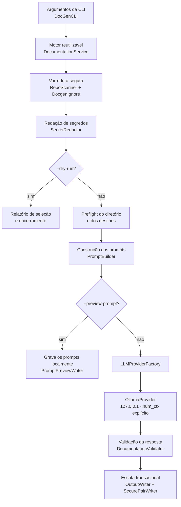

# DocGen CLI

> Referência da linha de comando, movida do [README](../README.md) para mantê-lo enxuto. A CLI está **✅ disponível** em `main` (`3.0.0-SNAPSHOT`): gera `README.md` e `ARCHITECTURE.md` de um repositório local usando só o Ollama.

## Visão geral

O **DocGen** nasceu como uma aplicação de linha de comando que lê um repositório local, seleciona os arquivos de texto relevantes e usa um modelo de linguagem (LLM) para redigir dois documentos:

| Documento | Conteúdo |
|---|---|
| `README.md` | Documentação geral do projeto. |
| `ARCHITECTURE.md` | Documentação da arquitetura de software. |

**O problema.** Documentação costuma ficar desatualizada ou nem chegar a ser escrita. Redigir um primeiro rascunho a partir do código é um trabalho repetitivo, que um LLM consegue acelerar. Ao mesmo tempo, enviar um repositório para um modelo traz riscos reais: vazamento de credenciais, envio não intencional de arquivos privados, prompt injection embutido no próprio código e respostas com conteúdo ativo indesejado.

**A abordagem.** O DocGen automatiza a geração do rascunho e trata o repositório como **dado não confiável** do início ao fim. A IA fica restrita a uma etapa bem delimitada do pipeline: recebe um retrato do repositório com limites rígidos de tamanho, segredos redigidos e conteúdo isolado por delimitadores. A resposta só é gravada em disco depois de passar por validações.

**Cenários de uso:**

- gerar um primeiro rascunho de documentação para projetos sem README;
- revisar ou atualizar a documentação de projetos existentes;
- documentar código de forma totalmente local, com o Ollama: nada sai da máquina;
- inspecionar com precisão o prompt que o modelo local receberia antes de gerar;
- planejar a arquitetura de um projeto novo a partir de requisitos e PDFs, com revisão humana antes de documentar (no workspace web, veja [api.md](api.md)).

> [!IMPORTANT]
> O DocGen produz **rascunhos**. A documentação gerada por IA pode conter imprecisões e deve ser revisada por uma pessoa antes de ser publicada.

## Principais funcionalidades

| Funcionalidade | Descrição |
|---|---|
| Análise automatizada de repositórios | Varredura determinística e limitada da árvore de arquivos, com seleção de arquivos de texto suportados. |
| Geração de README e arquitetura | Uma requisição para o `README.md` e outra para o `ARCHITECTURE.md`. |
| Integração com Ollama | Único provedor: o Ollama local em `127.0.0.1` (porta configurável, padrão `11434`), sem proxy do sistema. Modelo padrão: `qwen2.5-coder:7b`. |
| Execução local | Todo o processamento permanece na máquina; o DocGen não tem provedor remoto. |
| Janela de contexto explícita | Cada requisição informa `num_ctx` dimensionado pelo prompt. Se ele não couber no modelo, a geração falha antes de qualquer envio. |
| Modo de simulação (`--dry-run`) | Lista os arquivos incluídos e excluídos e encerra sem contatar nenhum provedor. |
| Pré-visualização de prompts (`--preview-prompt`) | Grava localmente os prompts exatos que seriam enviados, sem contatar nenhum provedor. |
| Exclusão de arquivos sensíveis | `.env*`, chaves privadas, keystores, `credentials*`, `*secret*`, contas de serviço e similares nunca são lidos. |
| Redação de segredos | Tokens conhecidos e credenciais são removidos do conteúdo e dos caminhos antes da montagem do prompt e novamente na resposta. |
| Respeito ao `.gitignore` | Arquivos `.gitignore` da raiz e aninhados são aplicados com semântica compatível com o Git. |
| Suporte a `.docgenignore` | Arquivo de exclusão adicional na raiz, apenas para exclusões. |
| Allowlist de extensões | `--include-ext` restringe a seleção a extensões específicas. |
| Controle de sobrescrita | Arquivos existentes só são substituídos com `--force`. |
| Validação da documentação gerada | Resposta completa, redigida novamente, limitada em tamanho e restrita a Markdown passivo. |
| Escrita transacional segura | Os dois arquivos são publicados como um par, com reversão em caso de falha. |

## Como o DocGen funciona

1. **Argumentos da CLI**: o picocli interpreta as opções em `DocGenCLI` e cria um `DocumentationRequest`.
2. **Orquestração reutilizável**: o `DocumentationService` executa o pipeline sem depender de terminal e devolve um `DocumentationResult` estruturado.
3. **Leitura do repositório**: o `RepoScanner` percorre a árvore apenas por meio de handles `SecureDirectoryStream`, sem seguir symlinks.
4. **Regras de exclusão**: exclusões internas, `.gitignore`, `.docgenignore` e `--include-ext`.
5. **Dados sensíveis**: arquivos sensíveis são ignorados e o `SecretRedactor` redige segredos no conteúdo e nos caminhos.
6. **Preflight**: o diretório de saída e os arquivos de destino são validados *antes* da construção dos prompts.
7. **Construção dos prompts**: o `PromptBuilder` isola o conteúdo como dado não confiável.
8. **Provedor**: o `LLMProviderFactory` cria o `OllamaProvider`, que consulta o contexto máximo do modelo e dimensiona `num_ctx`.
9. **Validação das respostas**: marcador de conclusão, nova redação e contrato de Markdown passivo (`DocumentationValidator`).
10. **Escrita segura**: o `OutputWriter` e o `SecurePairWriter` revalidam as condições e publicam o par de arquivos de forma transacional.



## Pré-requisitos

| Requisito | Detalhes |
|---|---|
| Java 21+ | Necessário para executar e compilar. |
| Maven 3.9+ | Necessário apenas para compilar a partir do código-fonte. |
| Ollama | Serviço em execução em `127.0.0.1` (porta `11434` ou a indicada em `--ollama-port`), com o modelo já instalado. O DocGen nunca baixa modelos sozinho. |
| Sistema de arquivos seguro | O provedor de sistema de arquivos do Java precisa implementar `SecureDirectoryStream`. Caso contrário, o DocGen falha (fail-closed) em vez de usar uma alternativa insegura. |
| Diretório de saída | Precisa **existir previamente**, ser confiável e não compartilhado. Em sistemas POSIX, não pode ter permissão de escrita para grupo ou outros usuários. |

> [!NOTE]
> Como a varredura e a escrita dependem de `SecureDirectoryStream`, sistemas de arquivos que não oferecem esse recurso são rejeitados. O DocGen nunca cria o diretório de saída por conta própria.

## Instalação

> [!WARNING]
> A release mais recente publicada é a **v2.0.0** (2026-10-22). Ela é anterior à versão 3.0 e ainda traz o provedor remoto e o login do workspace. Os instaladores por release abaixo instalam essa versão. Para usar o estado atual (`3.0.0-SNAPSHOT`, somente local), compile pelo código-fonte.

### Instalação por release

```bash
curl -fsSL https://raw.githubusercontent.com/brunocorreia-dev/Docgen/main/install.sh | sh
```

O script `install.sh`:

- exige Java instalado e `curl` ou `wget`, e aceita somente URLs HTTPS;
- baixa `docgen.jar` e `docgen.jar.sha256` da release mais recente de `brunocorreia-dev/Docgen`;
- **sempre** verifica o checksum SHA-256, que é interpretado de forma estrita;
- se o `cosign` estiver instalado, verifica as assinaturas Sigstore do JAR e do checksum, vinculadas ao workflow `release.yml` em uma tag;
- instala `docgen.jar` e o wrapper `docgen` em `$HOME/.local/bin`, diretório que pode ser alterado com `INSTALL_DIR`.

| Variável | Efeito |
|---|---|
| `INSTALL_DIR` | Diretório de instalação (padrão: `$HOME/.local/bin`). |
| `DOCGEN_REQUIRE_SIGNATURE=1` | Torna a verificação com cosign obrigatória. |
| `DOCGEN_SKIP_SIGNATURE=1` | Ignora explicitamente a verificação de assinatura e mantém só o checksum. |

As duas últimas variáveis são mutuamente exclusivas. Sem o cosign, o instalador continua apenas com o checksum e exibe um aviso.

### Compilação pelo código-fonte

```bash
# 1. Obter o repositório
git clone https://github.com/brunocorreia-dev/Docgen.git
cd Docgen

# 2. Executar os testes
mvn -B test

# 3. Compilar e gerar os JARs (target/docgen.jar e docgen-api/target/docgen-api.jar)
mvn -B package

# 4. Executar
java -jar target/docgen.jar --help
```

O repositório também inclui o script `./docgen`, que executa `target/docgen.jar` e repassa todos os argumentos. Para usá-lo, rode `mvn package` antes.

```bash
./docgen --version
```

## Guia de utilização

Os exemplos usam `java -jar target/docgen.jar`, gerado pelo build do código-fonte. Se você instalou pela release, substitua por `docgen`, mas lembre que a release publicada (v2.0.0) ainda tem o comportamento anterior à 3.0.

### 1. Preparar o diretório de saída

O DocGen não cria diretórios. Crie um diretório privado uma única vez:

```bash
mkdir -p ./generated
chmod 700 ./generated
```

### 2. Análise preliminar com `--dry-run`

Mostra quais arquivos seriam incluídos ou excluídos. Nada é enviado a nenhum provedor:

```bash
java -jar target/docgen.jar --dry-run /caminho/do/repositorio
```

Use este passo sempre que analisar um repositório pela primeira vez.

### 3. Pré-visualizar os prompts

Grava em `./generated` os prompts exatos que uma execução real enviaria (`docgen-readme.prompt.txt` e `docgen-architecture.prompt.txt`). Nenhum provedor é contatado:

```bash
java -jar target/docgen.jar --preview-prompt --output ./generated /caminho/do/repositorio
```

Os arquivos recebem permissões restritas ao proprietário quando há atributos POSIX disponíveis. Pré-visualizações existentes só são substituídas com `--force`.

### 4. Gerar a documentação

```bash
ollama pull qwen2.5-coder:7b   # uma vez: o DocGen não baixa modelos
java -jar target/docgen.jar --output ./generated /caminho/do/repositorio
```

A comunicação ocorre apenas com o Ollama no loopback IPv4 local. Se o modelo não estiver instalado, a CLI explica como instalá-lo e encerra sem baixar nada.

Antes de enviar, o DocGen estima o tamanho do prompt e pede ao Ollama uma janela de contexto (`num_ctx`) que caiba o prompt e a resposta. Se não couber no contexto máximo do modelo, a geração falha antes de qualquer envio, com orientação para reduzir a entrada (`--include-ext`, `.docgenignore`) ou escolher um modelo com contexto maior. Sem esse controle, o Ollama cortaria em silêncio o início do prompt, onde ficam as regras de segurança.

### 5. Sobrescrever arquivos existentes

`README.md` e `ARCHITECTURE.md` existentes só são substituídos com `--force`:

```bash
java -jar target/docgen.jar --force --output ./generated /caminho/do/repositorio
```

### 6. Selecionar extensões

Restringe a análise a extensões específicas. A opção apenas reduz a seleção padrão e nunca reinclui arquivos sensíveis:

```bash
java -jar target/docgen.jar --dry-run --include-ext java,md,xml /caminho/do/repositorio
```

### 7. Escolher o modelo e a porta

```bash
# Outro modelo já instalado no Ollama
java -jar target/docgen.jar --model <nome-do-modelo> --output ./generated /caminho/do/repositorio

# Ollama em outra porta (o host é sempre 127.0.0.1)
java -jar target/docgen.jar --ollama-port 11500 --output ./generated /caminho/do/repositorio
```

Sem `--model`, o padrão é `qwen2.5-coder:7b`, que tem janela de 32K tokens. Repositórios grandes podem exigir um modelo com contexto maior ou uma seleção menor.

## Referência completa da CLI

```text
docgen [opções] [<repositório>]
```

| Parâmetro | Tipo | Descrição | Exemplo |
|---|---|---|---|
| `<repositório>` | Posicional, opcional | Diretório a ser analisado. Padrão: diretório atual (`.`). | `/caminho/do/repo` |
| `--provider <ollama>` | Opcional | Mantido por compatibilidade; só aceita `ollama`. | `--provider ollama` |
| `--model <nome>` | Opcional | Modelo do Ollama, que precisa estar instalado. Padrão: `qwen2.5-coder:7b`. | `--model qwen2.5-coder:7b` |
| `--ollama-port <porta>` | Opcional | Porta do Ollama local (1 a 65535). O host é sempre `127.0.0.1`. Padrão: `11434`. | `--ollama-port 11500` |
| `--dry-run` | Opcional | Lista os arquivos incluídos e excluídos e encerra sem contatar provedores. | `--dry-run` |
| `--preview-prompt` | Opcional | Grava os prompts exatos no diretório de saída sem contatar provedores. | `--preview-prompt` |
| `--include-ext <exts>` | Opcional | Allowlist de extensões separadas por vírgula. Apenas restringe a seleção. | `--include-ext java,md,xml` |
| `-o`, `--output <dir>` | Opcional | Diretório de saída, que precisa existir. Padrão: diretório atual (`.`). | `-o ./generated` |
| `--force` | Opcional | Permite sobrescrever documentação ou pré-visualizações existentes. | `--force` |
| `-h`, `--help` | Opcional | Exibe a ajuda. | `--help` |
| `-V`, `--version` | Opcional | Exibe a versão (`docgen 3.0.0-SNAPSHOT`). | `--version` |

A CLI não usa chaves de API nem variáveis de ambiente de credenciais.

## Configuração da análise

Os controles abaixo **apenas restringem** a seleção. Nenhum deles amplia a varredura além das exclusões internas.

| Ordem | Controle | Comportamento |
|---|---|---|
| 1 | **Exclusões internas** | Diretórios de agentes, IDEs e build (como `.git`), snapshots de pré-visualização (`docgen-*.prompt.txt`) e caminhos sensíveis. São sempre aplicadas. |
| 2 | **`.gitignore`** | Arquivos da raiz e aninhados, com escopo. Suporta negação ordenada, BOM, `*`, `?`, intervalos ASCII entre colchetes e segmentos `**`, com correspondência em bytes UTF-8 compatível com o Git. |
| 3 | **`.docgenignore`** | Somente na raiz e somente para exclusão (detalhes abaixo). |
| 4 | **`--include-ext`** | Allowlist opcional de extensões que restringe o conjunto suportado. |
| 5 | **`--dry-run`** | Relatório local da seleção, sem contato com provedores. |

### `.gitignore`: comportamento conservador

- Classes POSIX, classes aninhadas ou não ASCII entre colchetes e padrões não NFC **falham** em vez de serem aproximados.
- Como o `core.ignoreCase` do repositório não é considerado confiável, são avaliados os estados sensível e insensível a maiúsculas (ASCII). Um caminho excluído por qualquer um deles permanece excluído.
- Um filho não pode ser reincluído enquanto o diretório pai estiver ignorado, e a negação de um diretório não cancela a exclusão mais específica de um filho.
- Nomes de arquivos de ignore com capitalização ambígua e caracteres de controle ambíguos falham. Caminhos não NFC ou com decodificação ambígua são excluídos.

### `.docgenignore`

```text
# Comentários (linhas iniciadas por #) e linhas em branco são ignorados.

# Sem "/": corresponde em qualquer profundidade
notes.md
*.sql

# Com "/": relativo à raiz
docs/internal.md

# "/" final: exclui o diretório e todo o seu conteúdo
docs/
```

A negação (`!`) é **rejeitada**: a varredura falha em vez de ignorar a linha silenciosamente.

### Limites da varredura

| Limite | Valor |
|---|---|
| Entradas descobertas | 4.096 |
| Arquivos tentados | 512 |
| Profundidade de diretórios | 64 níveis |
| Caracteres por caminho visível no prompt | 512 |
| Leitura por arquivo | 256 KiB |
| Caracteres de prompt por arquivo | 20.000 |
| Caracteres de conteúdo no total | 120.000 |
| Tamanho de cada arquivo de ignore | 64 KiB |
| Regras ordenadas | 512 |
| Globs compilados | 2.048 |
| Matchers de segmento | 8.192 |
| Estados NFA (ambos os modos de capitalização) | 250.000 |

A árvore de arquivos e os metadados de arquivos ignorados têm orçamentos próprios, e há também um orçamento global de trabalho de correspondência. Quando um limite é excedido, o fato é reportado ou a execução falha. Isso nunca resulta em alocação ilimitada, prompt ilimitado ou backtracking de expressões regulares.

### O que vai para o modelo local

Em cada uma das duas requisições ao Ollama: o conteúdo redigido dos arquivos incluídos, os caminhos relativos redigidos (também na forma de árvore limitada) e os nomes e motivos, redigidos e limitados, dos arquivos ignorados por limite de tamanho. **Nomes de arquivos sensíveis, ignorados, não suportados ou filtrados pela allowlist nunca entram no prompt.**

## Segurança

A segurança é um requisito central do DocGen. O detalhamento completo, incluindo a lista exata de dados enviados, está em [SECURITY.md](../SECURITY.md).

### Princípio fail-closed

Quando uma condição não pode ser verificada com segurança, como um sistema de arquivos sem `SecureDirectoryStream`, uma regra de ignore ambígua ou um limite excedido, o DocGen **falha ou exclui** o item. Ele nunca recorre a uma alternativa permissiva.

### Mecanismos de proteção

| Área | Proteção |
|---|---|
| **Somente local** | O único provedor é o Ollama em `127.0.0.1`: host fixo, sem resolução de nome, porta configurável, sem proxy do sistema e sem seguir redirecionamentos. Não há chaves de API. Um teste de arquitetura reprova o build se surgir no código de produção uma URL remota, outro cliente de rede ou outro provedor. |
| **Arquivos sensíveis** | `.env*`, chaves privadas, keystores, `credentials*`, `*secret*`, contas de serviço e lock files são excluídos antes de qualquer allowlist e **não podem ser reincluídos**, nem com `--include-ext`. Os nomes desses arquivos nunca entram no prompt. |
| **Redação de segredos** | Remove formatos comuns de tokens (AWS, Google, GitHub, GitLab, Slack, Stripe, SendGrid, Twilio, npm, PyPI, Hugging Face, DigitalOcean, Shopify, Azure, JWTs), blocos de chave privada, credenciais embutidas em URLs, cabeçalhos de autorização e atribuições de credenciais. A redação é aplicada ao arquivo completo antes do truncamento, a cada caminho e metadado visível no prompt e novamente sobre a resposta do modelo. |
| **Prompt injection** | O conteúdo do repositório é delimitado como dado não confiável, tags que imitam os delimitadores são neutralizadas e as regras de segurança são reafirmadas após o bloco de conteúdo. |
| **Symlinks** | A varredura e a escrita usam operações relativas a handles (`SecureDirectoryStream` com `NOFOLLOW_LINKS`). Symlinks na raiz, em ancestrais, diretórios, arquivos, arquivos de ignore e no caminho de saída nunca são seguidos. |
| **Escrita de arquivos** | O diretório de saída precisa existir, ser confiável e não compartilhado (em POSIX, sem escrita para grupo ou outros). A saída é preparada em canais privados `CREATE_NEW`, com verificação de identidade e digest. O par é publicado sem substituir um destino que surja concorrentemente e, em caso de falha, os originais são restaurados. |
| **Preflight** | Diretório inválido ou conflito de sobrescrita falham *antes* da construção dos prompts e da inicialização do provedor. A escrita final repete as validações para mitigar condições de corrida. |
| **Janela de contexto** | Cada requisição envia `num_ctx`, dimensionado por uma estimativa conservadora do prompt mais a reserva da resposta e limitado ao contexto máximo do modelo. Se não couber, a geração falha antes de qualquer envio; se o Ollama informar que avaliou menos tokens do que o prompt pode ter, a resposta é descartada. |
| **Permissões** | Pré-visualizações de prompt usam permissões restritas ao proprietário quando há atributos POSIX disponíveis. |
| **Respostas dos modelos** | Corpos de erro são descartados e a leitura é limitada. É obrigatório o marcador de conclusão bem-sucedida do Ollama. O corpo NDJSON do Ollama é limitado a 16 MiB. A saída é limitada a 2.000.000 caracteres, passa por verificação Unicode e de caracteres de controle, precisa começar com um H1 e usar Markdown passivo: sem HTML bruto, imagens, autolinks ou esquemas de link que não sejam web ou relativos. |
| **Inspeção** | `--dry-run` e `--preview-prompt` permitem auditar a seleção e os prompts sem cruzar nenhuma fronteira de rede. |

### Limitações dos mecanismos de proteção

- A redação de segredos é **baseada em padrões**. Ela não reconhece formatos proprietários ou sem prefixo, segredos divididos em várias linhas nem valores codificados ou ofuscados.
- As defesas contra prompt injection **reduzem o risco, mas não o eliminam**.
- A validação garante a **forma** da saída, não a **veracidade** do conteúdo.
- O Java NIO portátil não distingue hardlinks ou bind mounts de inodes legítimos. Não analise repositórios graváveis por usuários locais não confiáveis.
- A escrita do par é reversível em caso de falha, mas não funciona como um journal contra quedas abruptas do processo ou do sistema operacional.

> [!CAUTION]
> Os mecanismos automatizados reduzem riscos, mas **não substituem a revisão humana**. Revise a documentação gerada antes de publicá-la e use `--preview-prompt` sempre que houver dúvida sobre o conteúdo enviado.

Vulnerabilidades devem ser reportadas por meio de um security advisory privado ou diretamente ao proprietário do repositório, antes de qualquer divulgação pública.

## Limitações conhecidas

**Confirmadas na implementação e em [SECURITY.md](../SECURITY.md):**

- **Dependência de LLMs**: a qualidade da documentação depende do modelo escolhido. O texto gerado pode conter erros ou afirmações imprecisas, e a validação verifica apenas a forma.
- **Revisão humana obrigatória**: nenhum controle automatizado comprova a veracidade do conteúdo gerado.
- **Leitura limitada**: repositórios grandes são analisados apenas parcialmente, conforme os [limites da varredura](#limites-da-varredura). Arquivos acima dos limites são ignorados, e apenas seus nomes e motivos são informados ao modelo.
- **Sistema de arquivos**: é necessário suporte a `SecureDirectoryStream`. Hardlinks e bind mounts não são distinguíveis.
- **Diretório de saída**: precisa existir previamente e, em POSIX, não pode ter permissão de escrita para grupo ou outros usuários.
- **Redação best-effort**: formatos de segredo não reconhecidos podem passar despercebidos.
- **`.docgenignore` sem negação.**
- **Somente local**: o conteúdo nunca sai da máquina, mas o Ollama e o modelo precisam estar instalados, e a qualidade e a velocidade dependem do hardware. O timeout de requisição ao Ollama é de 10 minutos.
- **Janela de contexto**: a estimativa de tokens é conservadora (em código e prosa fica de 1,3 a 2 vezes acima da contagem real), então um repositório grande pode não caber no modelo padrão de 32K tokens. Nesse caso a geração falha e orienta como reduzir a entrada.
