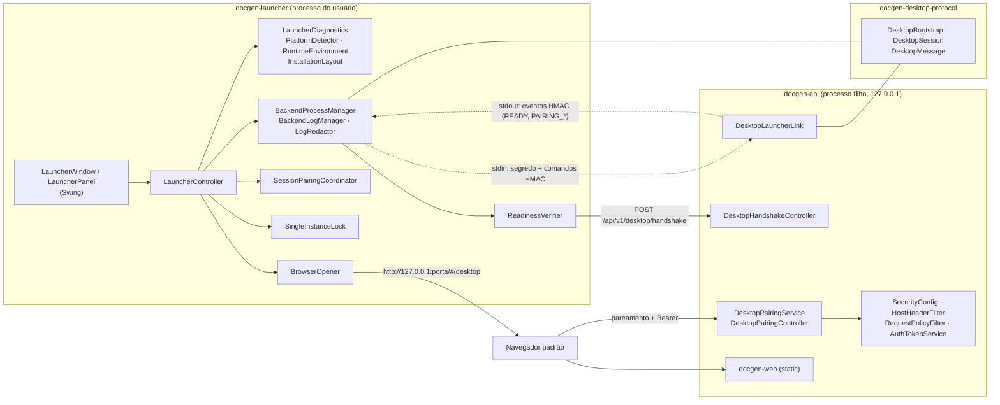

# DocGen Desktop — Arquitetura

> Seu assistente local e gratuito. Sua IA. Seu computador. Suas regras.

O DocGen Desktop é um launcher nativo (Swing, só JDK) que inicia a API Spring Boot do DocGen como processo
filho em `127.0.0.1`, prova que a API que responde na porta é esse filho e abre o workspace web existente
(`docgen-web`) no navegador padrão. Não há uma segunda interface web, Electron ou framework de UI.

## Estado da implementação

| Item | Estado |
|---|---|
| Módulos `docgen-launcher` e `docgen-desktop-protocol` no reactor Maven | Implementado |
| Diagnóstico de sistema, arquitetura, runtime, arquivos e permissões (`--diagnose`) | Implementado |
| Ciclo de vida do processo backend (start, supervisão, stop gracioso → SIGTERM → kill) | Implementado |
| Handshake de prontidão HMAC (stdout autenticado + desafio HTTP) | Implementado |
| Sessão do navegador por pareamento confirmado no launcher (sem senha) | Implementado |
| Janela Swing (estados reais, pareamento, logs, teclado) | Implementado; verificada por renderização offscreen e uma execução real via toolkit Wayland do JBR |
| Instância única, encerramento, reinício após falha, `--check` headless | Implementado |
| App image Linux com runtime `jlink` + `.tar.gz` + instalação por usuário | Implementado e verificado |
| Pacotes `.deb`/`.rpm` | Parcial: suportados pelo script, não verificados (ferramentas ausentes no ambiente de build) |
| Windows e macOS | Planejado: caminhos e layout preparados no código, nunca testados |
| Trazer a janela existente para frente ao abrir o app de novo | Planejado (hoje a segunda instância só avisa) |

## Componentes



Dependências Maven: `docgen-launcher → docgen-desktop-protocol` e `docgen-api → docgen-desktop-protocol`. O
protocolo usa só o JDK. A CLI não depende de nada novo, e o launcher não depende da API (só a executa).

## Ciclo de vida

```text
Usuário abre o DocGen
  → SingleInstanceLock (um launcher por usuário; o SO libera o lock se o processo morrer)
  → LauncherDiagnostics (somente leitura: SO, arquitetura, Java 21+, docgen-api.jar, diretórios)
  → BackendProcessManager.start()
      · porta fixa (DOCGEN_API_PORT/--port) já atendendo? → "Porta ocupada", nada é iniciado
      · java -jar docgen-api.jar --docgen.desktop.enabled=true --server.address=127.0.0.1 --server.port=0|N
      · stdin ← "docgen-desktop/1 bootstrap <sessão> <segredo>" (o pipe fica aberto: linha de vida)
      · stdout → linhas de log (redigidas) e eventos autenticados
      · aguarda READY(porta, pid) com MAC válido, ou saída do processo, ou timeout (90 s)
  → ReadinessVerifier: desafio HTTP com nonce novo → prova HMAC vinculada a sessão, pid e porta
  → "DocGen pronto!"
  → "Abrir DocGen": ARM → navegador em http://127.0.0.1:porta/#/desktop (sem credencial na URL)
  → pareamento confirmado na janela → token Bearer na aba
  → "Encerrar": fecha o stdin → shutdown gracioso → (15 s) SIGTERM → (5 s) kill → descendentes
```

Comportamentos definidos:

| Situação | Comportamento |
|---|---|
| Fechar a janela com o backend ativo | Pede confirmação; ao confirmar, encerra como "Encerrar". |
| Botão "Encerrar" | Encerra sem confirmação adicional (ação explícita). |
| Encerrar durante a inicialização | A inicialização é cancelada (sem esperar o timeout) e o processo é encerrado. |
| Backend travado | Linha de vida → SIGTERM → kill forçado, sempre só do processo que o launcher iniciou e dos descendentes dele. |
| Launcher recebe SIGTERM/logout | Hook de shutdown encerra o backend. |
| Launcher morto com SIGKILL | O backend vê EOF no stdin e encerra sozinho (sem órfãos). |
| Backend cai depois de pronto | Janela mostra "O backend foi encerrado inesperadamente" e oferece "Tentar novamente" (novo processo, novo segredo, nova verificação). |
| Navegador não abre | Janela mostra o endereço para abrir manualmente (sem segredo) e "Copiar endereço". |
| App aberto de novo / vários launchers | O segundo launcher encontra o lock e só informa que o DocGen já está aberto. |
| `docgen-server` usando os mesmos dados | O H2 recusa o segundo processo; a janela mostra "Dados em uso". |

O launcher nunca procura processos por porta ou por nome e nunca encerra o que não iniciou.

## Protocolo launcher ↔ API (`docgen-desktop/1`)

- **Segredo**: 32 bytes aleatórios + ID de sessão de 16 bytes, novos a cada inicialização, entregues só pelo
  stdin do filho. Nunca vão para argumentos (visíveis em `ps`), ambiente, arquivos ou HTTP.
- **Chaves derivadas** por HMAC-SHA256 com rótulos separados: `readiness`, `events`, `commands`. A rota de
  prontidão é um oráculo de MAC apenas para a chave `readiness`, que não autentica nenhuma outra mensagem.
- **Mensagens** (`@@docgen-desktop/1 <E|C> <seq> <TIPO> <campos…> <mac>`): MAC sobre versão, direção, sessão,
  sequência, tipo e campos; o receptor exige MAC válido e sequência estritamente crescente (rejeita
  falsificação, replay e reordenação). Campos restritos a `[A-Za-z0-9._:-]`.
- **Eventos** (API → launcher): `READY porta pid`, `PAIRING_REQUESTED id código expiração`, `PAIRING_CLOSED id motivo`.
- **Comandos** (launcher → API): `ARM`, `APPROVE id código`, `DENY id`. EOF no stdin = encerrar.
- **Prontidão HTTP**: `POST /api/v1/desktop/handshake {"nonce"}` → `{"protocol","proof"}`, com
  `proof = HMAC(k_readiness, sessão ‖ nonce ‖ pid ‖ porta local da conexão)`. O launcher compara em tempo
  constante; JSON com campos extras, proxy, redirect, outro status ou outro tipo de conteúdo falham. Cada nonce
  é respondido uma vez; requisições com `Origin`/`Sec-Fetch-Site` (navegadores) são recusadas.
- **Porta**: por padrão a própria API escolhe uma porta efêmera (`--server.port=0`) e a anuncia — não existe a
  janela "escolher porta livre → outro processo ocupa" do protótipo.

## Autenticação no modo desktop

- Não há senha: um `EnvironmentPostProcessor` troca `docgen.api.password` por um valor aleatório que só existe
  na memória da API. Login por senha e HTTP Basic ficam inutilizáveis, inclusive com `DOCGEN_API_PASSWORD`
  no ambiente (o launcher também o remove). Usuários adicionais impedem a inicialização.
- O usuário desktop é estável (`DOCGEN_API_USERNAME` válido ou o nome da conta do sistema saneado), porque os
  projetos no H2 pertencem a ele.
- **Pareamento**: "Abrir DocGen" envia `ARM` (janela de 2 min para um único pedido). A aba, pela rota `#/desktop`,
  cria o pedido com `fetch` JSON same-origin (`Origin` = `Host`, `X-DocGen-Client`) e recebe um segredo de
  consulta (só em memória) e um código `XXXX-XXXX`. A janela mostra o mesmo código com "Autorizar este
  navegador"/"Recusar". Após a aprovação, a aba troca o segredo por um token Bearer comum (uso único).
- Falha fechada: pedido sem ARM → recusado; segundo pedido simultâneo → ambos cancelados e desarmado; três
  segredos errados → cancelado; expiração em 2 min; pedidos que o launcher não armou são negados sem aparecer.
- A sessão resultante é a mesma do login normal (token opaco em memória, TTL 8 h, inatividade 30 min,
  `sessionStorage` da aba, revogação no logout). Sem cookies, sem CORS, CSRF continua barrado pelo
  `RequestPolicyFilter`, DNS rebinding pelo `HostHeaderFilter`.

## Arquivos e diretórios

| Plataforma | Dados (H2, staging) | Estado (lock) | Logs |
|---|---|---|---|
| Linux | `$DOCGEN_DATA_DIR` ou `$XDG_DATA_HOME/docgen` ou `~/.local/share/docgen` (o mesmo do `docgen-server`) | `$XDG_STATE_HOME/docgen` ou `~/.local/state/docgen` | `<estado>/logs` |
| macOS (não testado) | `~/Library/Application Support/DocGen/data` | `…/DocGen/launcher` | `~/Library/Logs/DocGen` |
| Windows (não testado) | `%LOCALAPPDATA%\DocGen\data` | `…\DocGen\launcher` | `…\DocGen\logs` |

Diretórios privados (0700, sem links simbólicos), arquivos de log 0600 criados com `CREATE_NEW`; os
`launcher.log`/`backend.log` das últimas cinco sessões são mantidos (`*.1.log` …), com limite de 8 MiB por
arquivo. Caminhos do ambiente só valem se forem absolutos e normalizados. Em pacotes, dados e logs nunca
ficam dentro da instalação.

## Decisões

1. **Swing em vez de JavaFX/Electron**: já está no JDK, não traz dependências e entra no runtime `jlink`.
2. **Módulo de protocolo compartilhado**: o formato é um contrato entre dois processos; um único código
   testado nos dois lados evita divergência.
3. **stdin como canal secreto e linha de vida**: é o único canal que só pai e filho possuem e resolve, de
   graça, a detecção da morte do launcher.
4. **Porta efêmera escolhida pela API**: elimina a corrida de porta; porta fixa continua possível e é testada
   antes (porta ocupada nunca é confundida com DocGen).
5. **Pareamento com confirmação humana em vez de token na URL**: URLs aparecem em `ps`, no histórico e em
   extensões; um código comparado na janela confiável não dá nada a quem só observa.
6. **Sem senha no modo desktop**: reduz a superfície (nenhuma senha temporária para exibir ou vazar).
7. **API jar fora do classpath do launcher** no pacote (`--app-content`).
